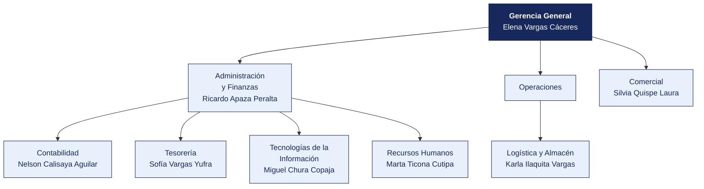

  <strong>AGROEXPORTADORA VALLE VIEJO S.A.C.</strong> 
  <em>Documento del caso</em>

---

# Organigrama y matriz de accesos al sistema principal

| | |
|---|---|
| **Organización** | AGROEXPORTADORA VALLE VIEJO S.A.C. |
| **Documento** | Organigrama y matriz de accesos al sistema principal |
| **Entregado por** | Recursos Humanos y Tecnologías de la Información |
| **Fecha de entrega** | 8 de abril de 2026 |
| **Clasificación** | Uso interno |

> Documento de una organización ficticia, elaborado para el curso. Cualquier parecido con una empresa real es coincidencia.

---

## 1. Estructura organizacional

**Personal en planilla.** 120. **Personal adicional.** 380 en campaña (may–ago).

> **Nota de la organización.** Tecnologías de la Información **reporta a Administración y Finanzas**, no a Gerencia General. La estructura no ha cambiado desde 2019.

## 2. Responsables por área

| Área | Responsable | Cargo | Desde |
|---|---|---|---|
| Gerencia General | Elena Vargas Cáceres | Analista | 2021 |
| Administración y Finanzas | Ricardo Apaza Peralta | Supervisor | 2020 |
| Contabilidad | Nelson Calisaya Aguilar | Asistente | 2019 |
| Tesorería | Sofía Vargas Yufra | Supervisor | 2025 |
| Logística y Almacén | Karla Ilaquita Vargas | Jefe | 2017 |
| Comercial | Silvia Quispe Laura | Coordinador | 2014 |
| Tecnologías de la Información | Miguel Chura Copaja | Operario | 2013 |
| Recursos Humanos | Marta Ticona Cutipa | Practicante | 2024 |

## 3. Matriz de accesos al sistema principal

Extraída del módulo de seguridad de **ERP** el 12 de marzo de 2026. Se entrega tal como la exportó el sistema.

| Usuario | Nombre | Área | Perfil | Alta | Último acceso | Estado | Segundo factor |
|---|---|---|---|---|---|---|---|
| `d.yufra` | Diana Yufra Ilaquita | Tecnologías de la Información | Almacén | 2018-11-13 | 2025-05-10 | Habilitado | No |
| `s.salazar` | Sofía Salazar Medina | Recursos Humanos | Consulta | 2013-02-12 | 2025-08-26 | Habilitado | No |
| `k.ilaquita` | Karla Ilaquita Vargas | Logística | Registro compras + Aprobación compras | 2017-04-06 | 2025-01-19 | Habilitado | No |
| `p.zapana` | Paola Zapana Bravo | Logística | Consulta | 2014-03-25 | 2025-09-26 | Habilitado | No |
| `s.quispe` | Silvia Quispe Laura | Comercial | Registro compras | 2014-11-14 | 2025-02-19 | Habilitado | No |
| `n.ramos` | Nadia Ramos Choque | Contabilidad | Tesorería | 2018-01-17 | 2025-08-28 | Habilitado | No |
| `s.vargas` | Sofía Vargas Yufra | Tesorería | Contabilidad | 2025-02-17 | 2025-10-24 | Habilitado | No |
| `m.ticona` | Marta Ticona Cutipa | Recursos Humanos | Almacén | 2024-05-26 | 2025-10-23 | Habilitado | No |
| `l.ramos` | Luis Ramos Rivera | Operaciones | Consulta | 2021-06-04 | 2025-04-21 | Habilitado | No |
| `k.maquera` | Karla Maquera Condori | Administración y Finanzas | Contabilidad | 2020-10-15 | 2025-04-30 | Habilitado | No |
| `j.bravo` | Julia Bravo Núñez | Recursos Humanos | Almacén | 2021-07-26 | 2025-04-28 | Habilitado | No |
| `n.mamani` | Nadia Mamani Vargas | Tesorería | Aprobación compras | 2015-01-07 | 2025-05-24 | Habilitado | No |
| `p.peralta` | Paola Peralta Mamani | Tesorería | Aprobación compras | 2012-04-03 | 2025-01-09 | Habilitado | No |
| `k.colque` | Karla Colque Nina | Comercial | Contabilidad | 2021-01-14 | 2025-02-04 | Habilitado | No |
| `s.flores` | Silvia Flores Yufra | Operaciones | Tesorería | 2016-06-20 | 2025-12-12 | Habilitado | No |
| `n.ancco` | Nelson Ancco Peralta | Almacén | Tesorería | 2015-07-19 | 2025-03-18 | Habilitado | No |
| `t.mamani` | Teresa Mamani Colque | Recursos Humanos | Registro compras | 2017-04-26 | 2025-03-07 | Habilitado | No |
| `v.salazar` | Víctor Salazar Maquera | Tecnologías de la Información | Almacén | 2025-10-22 | 2025-12-01 | Habilitado | No |

> La matriz completa, con los 97 usuarios, está en [`usuarios_erp.csv`](usuarios_erp.csv). Aquí se muestran los primeros 18.

## 4. Perfiles definidos en el sistema

| Perfil | Qué permite |
|---|---|
| Consulta | Ver información, sin modificar |
| Registro compras | Crear órdenes de compra y registrar facturas |
| Aprobación compras | Aprobar órdenes de compra y autorizar pagos |
| Tesorería | Ejecutar pagos y conciliar cuentas |
| Almacén | Registrar ingresos y salidas de mercadería |
| Contabilidad | Registrar asientos y cerrar periodos |
| Administrador | Todo lo anterior, más la gestión de usuarios y perfiles |

## 5. Procedimiento de altas y bajas, según la organización

> «Cuando ingresa personal, el jefe del área solicita el acceso por correo a Sistemas, indicando el perfil. Cuando alguien cesa, Recursos Humanos comunica la baja en la reunión semanal de coordinación. Sistemas la ejecuta. No llevamos un registro aparte porque el propio sistema guarda la fecha de alta.»
>
> — Marta Ticona Cutipa, Practicante

## 6. Lo que la organización declara sobre los accesos

| Pregunta | Respuesta de la organización |
|---|---|
| ¿Se revisan periódicamente los accesos vigentes? | «No de forma programada. Se revisa cuando hay un cambio grande» |
| ¿Existe una matriz de perfiles aprobada? | «Está la que exportó el sistema. Aprobada formalmente, no» |
| ¿Hay usuarios compartidos? | «Solo el de consulta, que usan en almacén cuando el titular no está» |
| ¿Se exige segundo factor? | «El sistema lo permite, pero no se activó para no complicar a los usuarios» |
| ¿Cuántas personas tienen perfil de administrador? | «Sistemas, que son 3. Y el jefe de Administración, por si acaso» |

## 7. Ceses del periodo comunicados por Recursos Humanos

| Código | Nombre | Área | Fecha de cese |
|---|---|---|---|
| EMP0002 | Diana Yufra Ilaquita | Tecnologías de la Información | 2020-10-15 |
| EMP0003 | Sofía Salazar Medina | Recursos Humanos | 2014-07-31 |
| EMP0007 | Nadia Ramos Choque | Contabilidad | 2025-02-06 |
| EMP0020 | Rosa Torres Ilaquita | Comercial | 2021-07-14 |
| EMP0027 | Víctor Salazar Maquera | Tecnologías de la Información | 2027-01-23 |
| EMP0050 | Óscar Paredes Ancco | Tesorería | 2012-08-11 |
| EMP0051 | Paola Choque Quispe | Almacén | 2028-01-02 |
| EMP0057 | Jorge Torres Peralta | Compras | 2020-11-12 |

> Recursos Humanos entrega esta relación.
