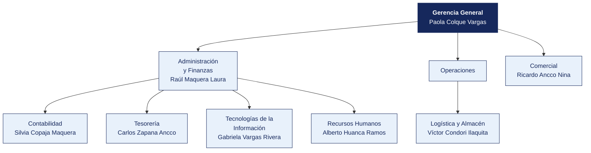

  <strong>CLÍNICA SAN RAMÓN S.A.C.</strong> 
  <em>Documento del caso</em>

---

# Organigrama y matriz de accesos al sistema principal

| | |
|---|---|
| **Organización** | CLÍNICA SAN RAMÓN S.A.C. |
| **Documento** | Organigrama y matriz de accesos al sistema principal |
| **Entregado por** | Recursos Humanos y Tecnologías de la Información |
| **Fecha de entrega** | 15 de mayo de 2026 |
| **Clasificación** | Uso interno |

> Documento de una organización ficticia, elaborado para el curso. Cualquier parecido con una empresa real es coincidencia.

---

## 1. Estructura organizacional

**Personal en planilla.** 178. **Personal adicional.** 46 médicos por honorarios.

> **Nota de la organización.** Tecnologías de la Información **reporta a Administración y Finanzas**, no a Gerencia General. La estructura no ha cambiado desde 2019.

## 2. Responsables por área

| Área | Responsable | Cargo | Desde |
|---|---|---|---|
| Gerencia General | Paola Colque Vargas | Asistente | 2025 |
| Administración y Finanzas | Raúl Maquera Laura | Supervisor | 2018 |
| Contabilidad | Silvia Copaja Maquera | Jefe | 2024 |
| Tesorería | Carlos Zapana Ancco | Asistente | 2021 |
| Logística y Almacén | Víctor Condori Ilaquita | Practicante | 2023 |
| Comercial | Ricardo Ancco Nina | Coordinador | 2018 |
| Tecnologías de la Información | Gabriela Vargas Rivera | Operario | 2018 |
| Recursos Humanos | Alberto Huanca Ramos | Practicante | 2019 |

## 3. Matriz de accesos al sistema principal

Extraída del módulo de seguridad de **HIS — historia clínica electrónica** el 12 de marzo de 2026. Se entrega tal como la exportó el sistema.

| Usuario | Nombre | Área | Perfil | Alta | Último acceso | Estado | Segundo factor |
|---|---|---|---|---|---|---|---|
| `ó.zapana` | Óscar Zapana Ilaquita | Almacén | Consulta | 2015-03-02 | 2025-07-21 | Habilitado | No |
| `g.apaza` | Gabriela Apaza Ancco | Compras | Registro compras | 2020-08-26 | 2025-12-05 | Habilitado | No |
| `s.rivera` | Sofía Rivera Maquera | Tesorería | Registro compras | 2012-11-03 | 2025-11-15 | Habilitado | No |
| `h.paredes` | Hugo Paredes Calisaya | Logística | Almacén | 2023-05-06 | 2025-06-16 | Habilitado | No |
| `l.choque` | Luis Choque Calisaya | Operaciones | Registro compras | 2021-11-06 | 2025-01-18 | Habilitado | No |
| `a.aguilar` | Ana Aguilar Maquera | Legal | Contabilidad | 2012-08-06 | 2025-05-24 | Habilitado | No |
| `s.copaja` | Silvia Copaja Maquera | Contabilidad | Registro compras | 2024-01-03 | 2025-08-04 | Habilitado | No |
| `i.aguilar` | Iván Aguilar Chura | Tecnologías de la Información | Almacén | 2019-12-14 | 2025-04-04 | Habilitado | No |
| `r.núñez` | Rosa Núñez Maquera | Almacén | Almacén | 2011-01-04 | 2025-11-27 | Habilitado | No |
| `r.maquera` | Raúl Maquera Laura | Administración y Finanzas | Contabilidad | 2018-10-27 | 2025-02-07 | Habilitado | No |
| `h.maquera` | Hugo Maquera Peralta | Contabilidad | Tesorería | 2024-11-04 | 2025-01-25 | Habilitado | No |
| `j.yufra` | Julio Yufra Condori | Legal | Consulta | 2020-11-03 | 2025-02-02 | Habilitado | No |
| `l.zapana` | Lucía Zapana Ticona | Contabilidad | Almacén | 2023-09-20 | 2025-04-21 | Habilitado | No |
| `p.ticona` | Paola Ticona Laura | Administración y Finanzas | Contabilidad | 2016-06-15 | 2025-03-19 | Habilitado | No |
| `n.torres` | Nadia Torres Ancco | Contabilidad | Registro compras | 2015-01-18 | 2025-10-12 | Habilitado | No |
| `a.laura` | Alberto Laura Aguilar | Administración y Finanzas | Aprobación compras | 2019-06-11 | 2025-07-29 | Habilitado | No |
| `v.condori` | Víctor Condori Ilaquita | Logística | Tesorería | 2023-04-18 | 2025-10-02 | Habilitado | No |
| `r.zapana` | Rocío Zapana Núñez | Recursos Humanos | Contabilidad | 2014-01-24 | 2025-08-25 | Habilitado | No |

> La matriz completa, con los 143 usuarios, está en [`usuarios_erp.csv`](usuarios_erp.csv). Aquí se muestran los primeros 18.

## 4. Perfiles definidos en el sistema

| Perfil | Qué permite |
|---|---|
| Consulta | Ver información, sin modificar |
| Registro compras | Crear órdenes de compra y registrar facturas |
| Aprobación compras | Aprobar órdenes de compra y autorizar pagos |
| Tesorería | Ejecutar pagos y conciliar cuentas |
| Almacén | Registrar ingresos y salidas de mercadería |
| Contabilidad | Registrar asientos y cerrar periodos |
| Administrador | Todo lo anterior, más la gestión de usuarios y perfiles |

## 5. Procedimiento de altas y bajas, según la organización

> «Cuando ingresa personal, el jefe del área solicita el acceso por correo a Sistemas, indicando el perfil. Cuando alguien cesa, Recursos Humanos comunica la baja en la reunión semanal de coordinación. Sistemas la ejecuta. No llevamos un registro aparte porque el propio sistema guarda la fecha de alta.»
>
> — Alberto Huanca Ramos, Practicante

## 6. Lo que la organización declara sobre los accesos

| Pregunta | Respuesta de la organización |
|---|---|
| ¿Se revisan periódicamente los accesos vigentes? | «No de forma programada. Se revisa cuando hay un cambio grande» |
| ¿Existe una matriz de perfiles aprobada? | «Está la que exportó el sistema. Aprobada formalmente, no» |
| ¿Hay usuarios compartidos? | «Solo el de consulta, que usan en almacén cuando el titular no está» |
| ¿Se exige segundo factor? | «El sistema lo permite, pero no se activó para no complicar a los usuarios» |
| ¿Cuántas personas tienen perfil de administrador? | «Sistemas, que son 4. Y el jefe de Administración, por si acaso» |

## 7. Ceses del periodo comunicados por Recursos Humanos

| Código | Nombre | Área | Fecha de cese |
|---|---|---|---|
| EMP0005 | Gabriela Apaza Ancco | Compras | 2023-10-22 |
| EMP0006 | Sofía Rivera Maquera | Tesorería | 2016-02-22 |
| EMP0008 | Hugo Paredes Calisaya | Logística | 2029-05-31 |
| EMP0010 | Ricardo Condori Cutipa | Tesorería | 2028-07-25 |
| EMP0019 | Lucía Zapana Ticona | Contabilidad | 2029-03-13 |
| EMP0020 | Alberto Mamani Ilaquita | Tesorería | 2023-11-22 |
| EMP0023 | Nadia Torres Ancco | Contabilidad | 2015-11-06 |
| EMP0026 | Rocío Zapana Núñez | Recursos Humanos | 2014-09-11 |

> Recursos Humanos entrega esta relación.
