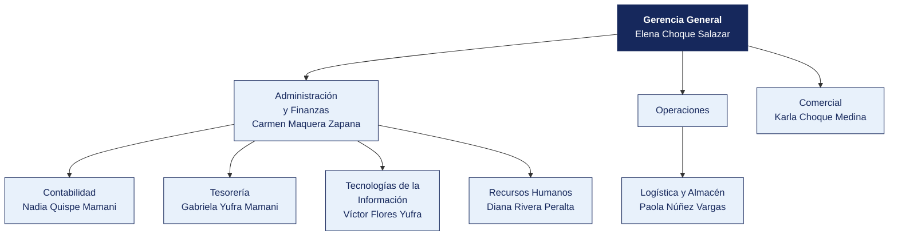

  <strong>MUNICIPALIDAD DISTRITAL DE ALTO SELVA</strong> 
  <em>Documento del caso</em>

---

# Organigrama y matriz de accesos al sistema principal

| | |
|---|---|
| **Organización** | MUNICIPALIDAD DISTRITAL DE ALTO SELVA |
| **Documento** | Organigrama y matriz de accesos al sistema principal |
| **Entregado por** | Recursos Humanos y Tecnologías de la Información |
| **Fecha de entrega** | 4 de mayo de 2026 |
| **Clasificación** | Uso interno |

> Documento de una organización ficticia, elaborado para el curso. Cualquier parecido con una empresa real es coincidencia.

---

## 1. Estructura organizacional

**Personal en planilla.** 155. **Personal adicional.** 94 bajo CAS y locación.

> **Nota de la organización.** Tecnologías de la Información **reporta a Administración y Finanzas**, no a Gerencia General. La estructura no ha cambiado desde 2019.

## 2. Responsables por área

| Área | Responsable | Cargo | Desde |
|---|---|---|---|
| Gerencia General | Elena Choque Salazar | Operario | 2021 |
| Administración y Finanzas | Carmen Maquera Zapana | Coordinador | 2025 |
| Contabilidad | Nadia Quispe Mamani | Asistente | 2016 |
| Tesorería | Gabriela Yufra Mamani | Supervisor | 2011 |
| Logística y Almacén | Paola Núñez Vargas | Jefe | 2025 |
| Comercial | Karla Choque Medina | Asistente | 2022 |
| Tecnologías de la Información | Víctor Flores Yufra | Operario | 2023 |
| Recursos Humanos | Diana Rivera Peralta | Supervisor | 2013 |

## 3. Matriz de accesos al sistema principal

Extraída del módulo de seguridad de **Rentas y catastro** el 12 de marzo de 2026. Se entrega tal como la exportó el sistema.

| Usuario | Nombre | Área | Perfil | Alta | Último acceso | Estado | Segundo factor |
|---|---|---|---|---|---|---|---|
| `e.flores` | Elena Flores Vargas | Administración y Finanzas | Aprobación compras | 2012-11-22 | 2025-02-16 | Habilitado | No |
| `c.maquera` | Carmen Maquera Zapana | Administración y Finanzas | Tesorería | 2025-02-08 | 2025-03-04 | Habilitado | No |
| `n.quispe` | Nadia Quispe Mamani | Contabilidad | Tesorería | 2016-11-18 | 2025-10-13 | Habilitado | No |
| `k.apaza` | Karla Apaza Rivera | Recursos Humanos | Registro compras | 2024-02-12 | 2025-05-17 | Habilitado | No |
| `p.núñez` | Paola Núñez Vargas | Logística | Registro compras | 2025-07-17 | 2025-08-25 | Habilitado | No |
| `c.bravo` | Carlos Bravo Huanca | Almacén | Consulta | 2024-09-04 | 2025-09-12 | Habilitado | No |
| `g.yufra` | Gabriela Yufra Mamani | Tesorería | Consulta | 2011-02-22 | 2025-11-04 | Habilitado | No |
| `k.choque` | Karla Choque Medina | Comercial | Contabilidad | 2022-01-12 | 2025-08-17 | Habilitado | No |
| `v.flores` | Víctor Flores Yufra | Tecnologías de la Información | Consulta | 2023-02-01 | 2025-11-11 | Habilitado | No |
| `r.copaja` | Rosa Copaja Ancco | Gerencia | Tesorería | 2013-03-09 | 2025-10-14 | Habilitado | No |
| `i.torres` | Iván Torres Maquera | Operaciones | Tesorería | 2011-03-11 | 2025-10-23 | Habilitado | No |
| `p.copaja` | Pedro Copaja Colque | Gerencia | Registro compras | 2015-05-20 | 2025-12-06 | Habilitado | No |
| `s.yufra` | Sofía Yufra Zapana | Compras | Consulta | 2012-09-08 | 2025-05-14 | Habilitado | No |
| `n.quispe` | Nadia Quispe Chura | Recursos Humanos | Contabilidad | 2018-11-17 | 2025-03-12 | Habilitado | No |
| `p.medina` | Pedro Medina Rivera | Recursos Humanos | Aprobación compras | 2013-06-11 | 2025-01-15 | Habilitado | No |
| `n.aguilar` | Nelson Aguilar Laura | Administración y Finanzas | Tesorería | 2015-08-13 | 2025-08-09 | Habilitado | No |
| `f.laura` | Fernando Laura Copaja | Recursos Humanos | Almacén | 2023-01-16 | 2025-02-25 | Habilitado | No |
| `r.aguilar` | Raúl Aguilar Cutipa | Administración y Finanzas | Tesorería | 2017-03-16 | 2025-08-21 | Habilitado | No |

> La matriz completa, con los 124 usuarios, está en [`usuarios_erp.csv`](usuarios_erp.csv). Aquí se muestran los primeros 18.

## 4. Perfiles definidos en el sistema

| Perfil | Qué permite |
|---|---|
| Consulta | Ver información, sin modificar |
| Registro compras | Crear órdenes de compra y registrar facturas |
| Aprobación compras | Aprobar órdenes de compra y autorizar pagos |
| Tesorería | Ejecutar pagos y conciliar cuentas |
| Almacén | Registrar ingresos y salidas de mercadería |
| Contabilidad | Registrar asientos y cerrar periodos |
| Administrador | Todo lo anterior, más la gestión de usuarios y perfiles |

## 5. Procedimiento de altas y bajas, según la organización

> «Cuando ingresa personal, el jefe del área solicita el acceso por correo a Sistemas, indicando el perfil. Cuando alguien cesa, Recursos Humanos comunica la baja en la reunión semanal de coordinación. Sistemas la ejecuta. No llevamos un registro aparte porque el propio sistema guarda la fecha de alta.»
>
> — Diana Rivera Peralta, Supervisor

## 6. Lo que la organización declara sobre los accesos

| Pregunta | Respuesta de la organización |
|---|---|
| ¿Se revisan periódicamente los accesos vigentes? | «No de forma programada. Se revisa cuando hay un cambio grande» |
| ¿Existe una matriz de perfiles aprobada? | «Está la que exportó el sistema. Aprobada formalmente, no» |
| ¿Hay usuarios compartidos? | «Solo el de consulta, que usan en almacén cuando el titular no está» |
| ¿Se exige segundo factor? | «El sistema lo permite, pero no se activó para no complicar a los usuarios» |
| ¿Cuántas personas tienen perfil de administrador? | «Sistemas, que son 3. Y el jefe de Administración, por si acaso» |

## 7. Ceses del periodo comunicados por Recursos Humanos

| Código | Nombre | Área | Fecha de cese |
|---|---|---|---|
| EMP0002 | Elena Flores Vargas | Administración y Finanzas | 2019-04-14 |
| EMP0013 | Silvia Choque Vargas | Legal | 2023-10-11 |
| EMP0017 | Miguel Ramos Copaja | Almacén | 2014-10-05 |
| EMP0021 | Sofía Yufra Zapana | Compras | 2018-10-21 |
| EMP0028 | Fernando Laura Copaja | Recursos Humanos | 2030-02-16 |
| EMP0035 | Lucía Cáceres Chura | Legal | 2021-11-30 |
| EMP0060 | Iván Salazar Ancco | Recursos Humanos | 2029-05-13 |
| EMP0084 | Paola Bravo Medina | Almacén | 2020-02-28 |

> Recursos Humanos entrega esta relación.
