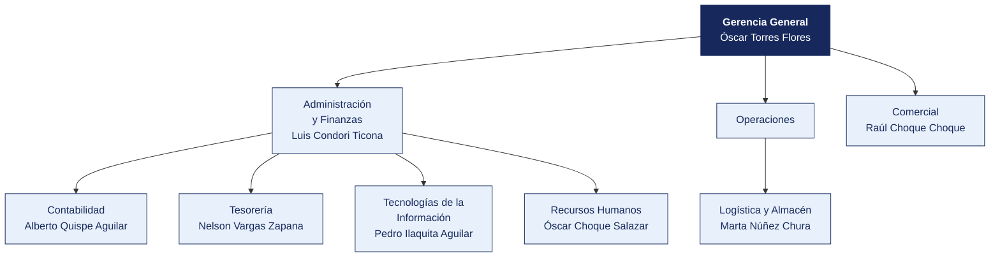

  <strong>COOPAC FRONTERA SUR</strong> 
  <em>Documento del caso</em>

---

# Organigrama y matriz de accesos al sistema principal

| | |
|---|---|
| **Organización** | COOPAC FRONTERA SUR |
| **Documento** | Organigrama y matriz de accesos al sistema principal |
| **Entregado por** | Recursos Humanos y Tecnologías de la Información |
| **Fecha de entrega** | 17 de mayo de 2026 |
| **Clasificación** | Uso interno |

> Documento de una organización ficticia, elaborado para el curso. Cualquier parecido con una empresa real es coincidencia.

---

## 1. Estructura organizacional

**Personal en planilla.** 84. **Personal adicional.** 12 promotores de campo.

> **Nota de la organización.** Tecnologías de la Información **reporta a Administración y Finanzas**, no a Gerencia General. La estructura no ha cambiado desde 2019.

## 2. Responsables por área

| Área | Responsable | Cargo | Desde |
|---|---|---|---|
| Gerencia General | Óscar Torres Flores | Asistente | 2011 |
| Administración y Finanzas | Luis Condori Ticona | Practicante | 2016 |
| Contabilidad | Alberto Quispe Aguilar | Analista | 2014 |
| Tesorería | Nelson Vargas Zapana | Coordinador | 2019 |
| Logística y Almacén | Marta Núñez Chura | Practicante | 2015 |
| Comercial | Raúl Choque Choque | Jefe | 2011 |
| Tecnologías de la Información | Pedro Ilaquita Aguilar | Supervisor | 2024 |
| Recursos Humanos | Óscar Choque Salazar | Analista | 2022 |

## 3. Matriz de accesos al sistema principal

Extraída del módulo de seguridad de **Core financiero** el 12 de marzo de 2026. Se entrega tal como la exportó el sistema.

| Usuario | Nombre | Área | Perfil | Alta | Último acceso | Estado | Segundo factor |
|---|---|---|---|---|---|---|---|
| `m.núñez` | Marta Núñez Chura | Logística | Registro compras | 2015-09-27 | 2025-08-16 | Habilitado | No |
| `p.ilaquita` | Pedro Ilaquita Aguilar | Tecnologías de la Información | Consulta | 2024-07-02 | 2025-04-11 | Habilitado | No |
| `ó.torres` | Óscar Torres Flores | Gerencia | Registro compras + Aprobación compras | 2011-02-16 | 2025-06-15 | Habilitado | No |
| `l.condori` | Luis Condori Ticona | Administración y Finanzas | Contabilidad | 2016-11-16 | 2025-07-01 | Habilitado | No |
| `a.quispe` | Alberto Quispe Aguilar | Contabilidad | Contabilidad | 2014-08-14 | 2025-08-12 | Habilitado | No |
| `l.núñez` | Luis Núñez Núñez | Contabilidad | Aprobación compras | 2025-07-21 | 2025-08-26 | Habilitado | No |
| `á.salazar` | Álvaro Salazar Torres | Administración y Finanzas | Aprobación compras | 2014-07-18 | 2025-07-19 | Habilitado | No |
| `t.condori` | Teresa Condori Cutipa | Tecnologías de la Información | Almacén | 2023-05-01 | 2025-01-24 | Habilitado | No |
| `m.colque` | Miguel Colque Medina | Tecnologías de la Información | Consulta | 2011-12-10 | 2025-11-14 | Habilitado | No |
| `n.vargas` | Nelson Vargas Zapana | Tesorería | Registro compras + Aprobación compras | 2019-04-10 | 2025-03-10 | Habilitado | No |
| `s.mamani` | Silvia Mamani Medina | Tecnologías de la Información | Consulta | 2019-02-15 | 2025-10-28 | Habilitado | No |
| `r.choque` | Raúl Choque Choque | Comercial | Tesorería | 2011-03-14 | 2025-07-31 | Habilitado | No |
| `l.colque` | Luis Colque Apaza | Almacén | Aprobación compras | 2017-08-17 | 2025-12-02 | Habilitado | No |
| `p.huanca` | Pedro Huanca Vargas | Legal | Aprobación compras | 2022-07-02 | 2025-08-26 | Habilitado | No |
| `l.laura` | Lucía Laura Flores | Tecnologías de la Información | Aprobación compras | 2023-08-21 | 2025-08-05 | Habilitado | No |
| `n.rivera` | Nadia Rivera Copaja | Tesorería | Almacén | 2013-11-22 | 2025-07-11 | Habilitado | No |
| `m.paredes` | Marta Paredes Medina | Administración y Finanzas | Registro compras | 2019-01-23 | 2025-09-24 | Habilitado | No |
| `r.paredes` | Ricardo Paredes Calisaya | Comercial | Consulta | 2021-10-06 | 2025-11-29 | Habilitado | No |

> La matriz completa, con los 75 usuarios, está en [`usuarios_erp.csv`](usuarios_erp.csv). Aquí se muestran los primeros 18.

## 4. Perfiles definidos en el sistema

| Perfil | Qué permite |
|---|---|
| Consulta | Ver información, sin modificar |
| Registro compras | Crear órdenes de compra y registrar facturas |
| Aprobación compras | Aprobar órdenes de compra y autorizar pagos |
| Tesorería | Ejecutar pagos y conciliar cuentas |
| Almacén | Registrar ingresos y salidas de mercadería |
| Contabilidad | Registrar asientos y cerrar periodos |
| Administrador | Todo lo anterior, más la gestión de usuarios y perfiles |

## 5. Procedimiento de altas y bajas, según la organización

> «Cuando ingresa personal, el jefe del área solicita el acceso por correo a Sistemas, indicando el perfil. Cuando alguien cesa, Recursos Humanos comunica la baja en la reunión semanal de coordinación. Sistemas la ejecuta. No llevamos un registro aparte porque el propio sistema guarda la fecha de alta.»
>
> — Óscar Choque Salazar, Analista

## 6. Lo que la organización declara sobre los accesos

| Pregunta | Respuesta de la organización |
|---|---|
| ¿Se revisan periódicamente los accesos vigentes? | «No de forma programada. Se revisa cuando hay un cambio grande» |
| ¿Existe una matriz de perfiles aprobada? | «Está la que exportó el sistema. Aprobada formalmente, no» |
| ¿Hay usuarios compartidos? | «Solo el de consulta, que usan en almacén cuando el titular no está» |
| ¿Se exige segundo factor? | «El sistema lo permite, pero no se activó para no complicar a los usuarios» |
| ¿Cuántas personas tienen perfil de administrador? | «Sistemas, que son 5. Y el jefe de Administración, por si acaso» |

## 7. Ceses del periodo comunicados por Recursos Humanos

| Código | Nombre | Área | Fecha de cese |
|---|---|---|---|
| EMP0008 | Luis Núñez Núñez | Contabilidad | 2031-10-19 |
| EMP0014 | Silvia Mamani Medina | Tecnologías de la Información | 2022-01-07 |
| EMP0017 | Rosa Mamani Peralta | Legal | 2031-03-12 |
| EMP0020 | Lucía Laura Flores | Tecnologías de la Información | 2028-06-26 |
| EMP0045 | Iván Laura Huanca | Operaciones | 2023-03-18 |
| EMP0051 | Nadia Ilaquita Choque | Almacén | 2024-06-23 |
| EMP0057 | Nadia Salazar Ramos | Legal | 2021-05-19 |
| EMP0059 | Nadia Ticona Flores | Contabilidad | 2024-05-12 |

> Recursos Humanos entrega esta relación.
