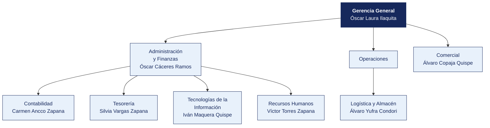

  <strong>TRANSPORTES SUR ANDINO S.A.</strong> 
  <em>Documento del caso</em>

---

# Organigrama y matriz de accesos al sistema principal

| | |
|---|---|
| **Organización** | TRANSPORTES SUR ANDINO S.A. |
| **Documento** | Organigrama y matriz de accesos al sistema principal |
| **Entregado por** | Recursos Humanos y Tecnologías de la Información |
| **Fecha de entrega** | 19 de abril de 2026 |
| **Clasificación** | Uso interno |

> Documento de una organización ficticia, elaborado para el curso. Cualquier parecido con una empresa real es coincidencia.

---

## 1. Estructura organizacional

**Personal en planilla.** 232. **Personal adicional.** Conductores en régimen mixto.

> **Nota de la organización.** Tecnologías de la Información **reporta a Administración y Finanzas**, no a Gerencia General. La estructura no ha cambiado desde 2019.

## 2. Responsables por área

| Área | Responsable | Cargo | Desde |
|---|---|---|---|
| Gerencia General | Óscar Laura Ilaquita | Analista | 2019 |
| Administración y Finanzas | Óscar Cáceres Ramos | Coordinador | 2022 |
| Contabilidad | Carmen Ancco Zapana | Analista | 2021 |
| Tesorería | Silvia Vargas Zapana | Practicante | 2019 |
| Logística y Almacén | Álvaro Yufra Condori | Practicante | 2015 |
| Comercial | Álvaro Copaja Quispe | Jefe | 2011 |
| Tecnologías de la Información | Iván Maquera Quispe | Practicante | 2023 |
| Recursos Humanos | Víctor Torres Zapana | Jefe | 2017 |

## 3. Matriz de accesos al sistema principal

Extraída del módulo de seguridad de **Venta de pasajes y manifiesto** el 12 de marzo de 2026. Se entrega tal como la exportó el sistema.

| Usuario | Nombre | Área | Perfil | Alta | Último acceso | Estado | Segundo factor |
|---|---|---|---|---|---|---|---|
| `d.mamani` | Diana Mamani Choque | Legal | Consulta | 2014-04-15 | 2025-06-14 | Habilitado | No |
| `á.copaja` | Álvaro Copaja Ramos | Administración y Finanzas | Tesorería | 2017-12-23 | 2025-11-09 | Habilitado | No |
| `h.maquera` | Hugo Maquera Quispe | Recursos Humanos | Almacén | 2012-12-25 | 2025-02-17 | Habilitado | No |
| `s.vargas` | Silvia Vargas Zapana | Tesorería | Registro compras | 2019-04-03 | 2025-04-05 | Habilitado | No |
| `c.ancco` | Carmen Ancco Zapana | Contabilidad | Aprobación compras | 2021-10-15 | 2025-09-20 | Habilitado | No |
| `j.bravo` | Julio Bravo Ticona | Logística | Registro compras | 2015-03-09 | 2025-11-16 | Habilitado | No |
| `r.ancco` | Rocío Ancco Vargas | Operaciones | Contabilidad | 2013-06-06 | 2025-11-16 | Habilitado | No |
| `h.torres` | Hugo Torres Choque | Compras | Aprobación compras | 2025-07-02 | 2025-12-10 | Habilitado | No |
| `v.chura` | Víctor Chura Colque | Contabilidad | Tesorería | 2021-12-09 | 2025-05-24 | Habilitado | No |
| `á.copaja` | Álvaro Copaja Quispe | Comercial | Consulta | 2011-12-07 | 2025-01-11 | Habilitado | No |
| `i.maquera` | Iván Maquera Quispe | Tecnologías de la Información | Almacén | 2023-12-25 | 2025-12-29 | Habilitado | No |
| `m.vargas` | Miguel Vargas Peralta | Administración y Finanzas | Aprobación compras | 2020-02-08 | 2025-01-19 | Habilitado | No |
| `a.laura` | Ana Laura Maquera | Logística | Tesorería | 2022-02-19 | 2025-03-16 | Habilitado | No |
| `r.calisaya` | Rosa Calisaya Aguilar | Comercial | Almacén | 2014-05-19 | 2025-01-02 | Habilitado | No |
| `ó.laura` | Óscar Laura Ilaquita | Gerencia | Tesorería | 2019-11-01 | 2025-04-02 | Habilitado | No |
| `k.cáceres` | Karla Cáceres Cáceres | Gerencia | Contabilidad | 2022-07-11 | 2025-03-03 | Habilitado | No |
| `k.bravo` | Karla Bravo Condori | Almacén | Consulta | 2025-06-15 | 2025-08-03 | Habilitado | No |
| `a.rivera` | Ana Rivera Cutipa | Comercial | Almacén | 2025-12-02 | 2025-12-28 | Habilitado | No |

> La matriz completa, con los 181 usuarios, está en [`usuarios_erp.csv`](usuarios_erp.csv). Aquí se muestran los primeros 18.

## 4. Perfiles definidos en el sistema

| Perfil | Qué permite |
|---|---|
| Consulta | Ver información, sin modificar |
| Registro compras | Crear órdenes de compra y registrar facturas |
| Aprobación compras | Aprobar órdenes de compra y autorizar pagos |
| Tesorería | Ejecutar pagos y conciliar cuentas |
| Almacén | Registrar ingresos y salidas de mercadería |
| Contabilidad | Registrar asientos y cerrar periodos |
| Administrador | Todo lo anterior, más la gestión de usuarios y perfiles |

## 5. Procedimiento de altas y bajas, según la organización

> «Cuando ingresa personal, el jefe del área solicita el acceso por correo a Sistemas, indicando el perfil. Cuando alguien cesa, Recursos Humanos comunica la baja en la reunión semanal de coordinación. Sistemas la ejecuta. No llevamos un registro aparte porque el propio sistema guarda la fecha de alta.»
>
> — Víctor Torres Zapana, Jefe

## 6. Lo que la organización declara sobre los accesos

| Pregunta | Respuesta de la organización |
|---|---|
| ¿Se revisan periódicamente los accesos vigentes? | «No de forma programada. Se revisa cuando hay un cambio grande» |
| ¿Existe una matriz de perfiles aprobada? | «Está la que exportó el sistema. Aprobada formalmente, no» |
| ¿Hay usuarios compartidos? | «Solo el de consulta, que usan en almacén cuando el titular no está» |
| ¿Se exige segundo factor? | «El sistema lo permite, pero no se activó para no complicar a los usuarios» |
| ¿Cuántas personas tienen perfil de administrador? | «Sistemas, que son 4. Y el jefe de Administración, por si acaso» |

## 7. Ceses del periodo comunicados por Recursos Humanos

| Código | Nombre | Área | Fecha de cese |
|---|---|---|---|
| EMP0004 | Álvaro Copaja Ramos | Administración y Finanzas | 2024-11-09 |
| EMP0010 | Julio Bravo Ticona | Logística | 2017-06-14 |
| EMP0013 | Hugo Torres Choque | Compras | 2028-01-22 |
| EMP0023 | Fernando Calisaya Chura | Almacén | 2020-08-23 |
| EMP0037 | Rocío Cutipa Cáceres | Recursos Humanos | 2022-01-20 |
| EMP0049 | Jorge Condori Ticona | Almacén | 2027-07-17 |
| EMP0050 | Elena Cutipa Peralta | Tecnologías de la Información | 2021-05-07 |
| EMP0061 | Karla Aguilar Torres | Contabilidad | 2020-09-17 |

> Recursos Humanos entrega esta relación.
