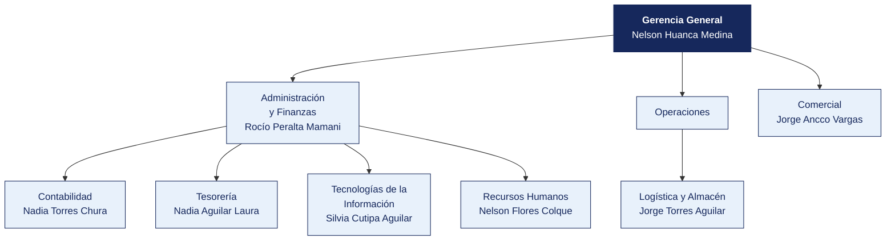

  <strong>DISTRIBUIDORA ANDINA DEL SUR S.A.C.</strong> 
  <em>Documento del caso</em>

---

# Organigrama y matriz de accesos al sistema principal

| | |
|---|---|
| **Organización** | DISTRIBUIDORA ANDINA DEL SUR S.A.C. |
| **Documento** | Organigrama y matriz de accesos al sistema principal |
| **Entregado por** | Recursos Humanos y Tecnologías de la Información |
| **Fecha de entrega** | 9 de marzo de 2026 |
| **Clasificación** | Uso interno |

> Documento de una organización ficticia, elaborado para el curso. Cualquier parecido con una empresa real es coincidencia.

---

## 1. Estructura organizacional

**Personal en planilla.** 132. **Personal adicional.** 34 en temporada alta.

> **Nota de la organización.** Tecnologías de la Información **reporta a Administración y Finanzas**, no a Gerencia General. La estructura no ha cambiado desde 2019.

## 2. Responsables por área

| Área | Responsable | Cargo | Desde |
|---|---|---|---|
| Gerencia General | Nelson Huanca Medina | Asistente | 2024 |
| Administración y Finanzas | Rocío Peralta Mamani | Analista | 2022 |
| Contabilidad | Nadia Torres Chura | Practicante | 2025 |
| Tesorería | Nadia Aguilar Laura | Asistente | 2016 |
| Logística y Almacén | Jorge Torres Aguilar | Supervisor | 2013 |
| Comercial | Jorge Ancco Vargas | Jefe | 2015 |
| Tecnologías de la Información | Silvia Cutipa Aguilar | Jefe | 2021 |
| Recursos Humanos | Nelson Flores Colque | Coordinador | 2017 |

## 3. Matriz de accesos al sistema principal

Extraída del módulo de seguridad de **ERP comercial** el 12 de marzo de 2026. Se entrega tal como la exportó el sistema.

| Usuario | Nombre | Área | Perfil | Alta | Último acceso | Estado | Segundo factor |
|---|---|---|---|---|---|---|---|
| `n.núñez` | Nadia Núñez Quispe | Legal | Consulta | 2023-12-16 | 2025-08-27 | Habilitado | No |
| `j.torres` | Jorge Torres Aguilar | Logística | Consulta | 2013-02-01 | 2025-02-09 | Habilitado | No |
| `t.ticona` | Teresa Ticona Vargas | Almacén | Tesorería | 2022-02-21 | 2025-09-09 | Habilitado | No |
| `n.aguilar` | Nadia Aguilar Laura | Tesorería | Tesorería | 2016-10-12 | 2025-12-11 | Habilitado | No |
| `r.zapana` | Raúl Zapana Aguilar | Compras | Contabilidad | 2014-01-12 | 2025-09-11 | Habilitado | No |
| `n.flores` | Nelson Flores Ramos | Tesorería | Registro compras | 2025-04-23 | 2025-05-01 | Habilitado | No |
| `s.cutipa` | Silvia Cutipa Aguilar | Tecnologías de la Información | Tesorería | 2021-04-14 | 2025-01-03 | Habilitado | No |
| `m.aguilar` | Marta Aguilar Mamani | Tesorería | Almacén | 2020-05-06 | 2025-06-14 | Habilitado | No |
| `a.apaza` | Alberto Apaza Vargas | Tecnologías de la Información | Almacén | 2023-06-10 | 2025-03-04 | Habilitado | No |
| `m.ticona` | Miguel Ticona Vargas | Tesorería | Aprobación compras | 2017-10-12 | 2025-11-12 | Habilitado | No |
| `j.ancco` | Julio Ancco Salazar | Tesorería | Consulta | 2023-12-18 | 2025-02-18 | Habilitado | No |
| `r.peralta` | Rocío Peralta Mamani | Administración y Finanzas | Registro compras | 2022-06-04 | 2025-03-14 | Habilitado | No |
| `t.cutipa` | Teresa Cutipa Nina | Administración y Finanzas | Consulta | 2019-09-22 | 2025-06-23 | Habilitado | No |
| `ó.ancco` | Óscar Ancco Peralta | Legal | Consulta | 2025-02-16 | 2025-10-30 | Habilitado | No |
| `a.cutipa` | Alberto Cutipa Copaja | Compras | Contabilidad | 2020-03-14 | 2025-06-24 | Habilitado | No |
| `á.quispe` | Álvaro Quispe Chura | Legal | Consulta | 2011-08-07 | 2025-08-01 | Habilitado | No |
| `r.copaja` | Rosa Copaja Vargas | Almacén | Aprobación compras | 2011-04-17 | 2025-05-09 | Habilitado | No |
| `k.maquera` | Karla Maquera Ramos | Legal | Consulta | 2017-11-08 | 2025-03-04 | Habilitado | No |

> La matriz completa, con los 119 usuarios, está en [`usuarios_erp.csv`](usuarios_erp.csv). Aquí se muestran los primeros 18.

## 4. Perfiles definidos en el sistema

| Perfil | Qué permite |
|---|---|
| Consulta | Ver información, sin modificar |
| Registro compras | Crear órdenes de compra y registrar facturas |
| Aprobación compras | Aprobar órdenes de compra y autorizar pagos |
| Tesorería | Ejecutar pagos y conciliar cuentas |
| Almacén | Registrar ingresos y salidas de mercadería |
| Contabilidad | Registrar asientos y cerrar periodos |
| Administrador | Todo lo anterior, más la gestión de usuarios y perfiles |

## 5. Procedimiento de altas y bajas, según la organización

> «Cuando ingresa personal, el jefe del área solicita el acceso por correo a Sistemas, indicando el perfil. Cuando alguien cesa, Recursos Humanos comunica la baja en la reunión semanal de coordinación. Sistemas la ejecuta. No llevamos un registro aparte porque el propio sistema guarda la fecha de alta.»
>
> — Nelson Flores Colque, Coordinador

## 6. Lo que la organización declara sobre los accesos

| Pregunta | Respuesta de la organización |
|---|---|
| ¿Se revisan periódicamente los accesos vigentes? | «No de forma programada. Se revisa cuando hay un cambio grande» |
| ¿Existe una matriz de perfiles aprobada? | «Está la que exportó el sistema. Aprobada formalmente, no» |
| ¿Hay usuarios compartidos? | «Solo el de consulta, que usan en almacén cuando el titular no está» |
| ¿Se exige segundo factor? | «El sistema lo permite, pero no se activó para no complicar a los usuarios» |
| ¿Cuántas personas tienen perfil de administrador? | «Sistemas, que son 4. Y el jefe de Administración, por si acaso» |

## 7. Ceses del periodo comunicados por Recursos Humanos

| Código | Nombre | Área | Fecha de cese |
|---|---|---|---|
| EMP0003 | Teresa Ticona Vargas | Almacén | 2028-06-02 |
| EMP0005 | Raúl Zapana Aguilar | Compras | 2015-02-08 |
| EMP0006 | Nelson Flores Ramos | Tesorería | 2026-05-24 |
| EMP0014 | Teresa Cutipa Nina | Administración y Finanzas | 2024-01-28 |
| EMP0021 | Karla Maquera Ramos | Legal | 2019-09-12 |
| EMP0026 | Vanessa Vargas Paredes | Compras | 2020-11-02 |
| EMP0027 | Silvia Quispe Medina | Legal | 2017-02-07 |
| EMP0033 | Carmen Maquera Ramos | Compras | 2013-09-19 |

> Recursos Humanos entrega esta relación.
