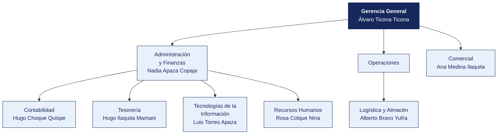

  <strong>INSTITUTO SUPERIOR TECNOLÓGICO VERTIENTE SUR</strong> 
  <em>Documento del caso</em>

---

# Organigrama y matriz de accesos al sistema principal

| | |
|---|---|
| **Organización** | INSTITUTO SUPERIOR TECNOLÓGICO VERTIENTE SUR |
| **Documento** | Organigrama y matriz de accesos al sistema principal |
| **Entregado por** | Recursos Humanos y Tecnologías de la Información |
| **Fecha de entrega** | 17 de marzo de 2026 |
| **Clasificación** | Uso interno |

> Documento de una organización ficticia, elaborado para el curso. Cualquier parecido con una empresa real es coincidencia.

---

## 1. Estructura organizacional

**Personal en planilla.** 81. **Personal adicional.** 112 docentes por horas.

> **Nota de la organización.** Tecnologías de la Información **reporta a Administración y Finanzas**, no a Gerencia General. La estructura no ha cambiado desde 2019.

## 2. Responsables por área

| Área | Responsable | Cargo | Desde |
|---|---|---|---|
| Gerencia General | Álvaro Ticona Ticona | Practicante | 2012 |
| Administración y Finanzas | Nadia Apaza Copaja | Jefe | 2012 |
| Contabilidad | Hugo Choque Quispe | Jefe | 2017 |
| Tesorería | Hugo Ilaquita Mamani | Operario | 2012 |
| Logística y Almacén | Alberto Bravo Yufra | Supervisor | 2015 |
| Comercial | Ana Medina Ilaquita | Asistente | 2022 |
| Tecnologías de la Información | Luis Torres Apaza | Asistente | 2025 |
| Recursos Humanos | Rosa Colque Nina | Coordinador | 2024 |

## 3. Matriz de accesos al sistema principal

Extraída del módulo de seguridad de **Sistema académico** el 12 de marzo de 2026. Se entrega tal como la exportó el sistema.

| Usuario | Nombre | Área | Perfil | Alta | Último acceso | Estado | Segundo factor |
|---|---|---|---|---|---|---|---|
| `a.medina` | Ana Medina Ilaquita | Comercial | Tesorería | 2022-10-17 | 2025-11-09 | Habilitado | No |
| `c.calisaya` | Carlos Calisaya Paredes | Administración y Finanzas | Almacén | 2023-08-20 | 2025-04-11 | Habilitado | No |
| `l.ramos` | Lucía Ramos Apaza | Operaciones | Almacén | 2025-10-20 | 2025-10-21 | Habilitado | No |
| `l.torres` | Luis Torres Apaza | Tecnologías de la Información | Registro compras + Aprobación compras | 2025-03-05 | 2025-07-08 | Habilitado | No |
| `a.bravo` | Alberto Bravo Cutipa | Tecnologías de la Información | Almacén | 2016-12-02 | 2025-11-11 | Habilitado | No |
| `a.bravo` | Alberto Bravo Yufra | Logística | Almacén | 2015-01-04 | 2025-05-30 | Habilitado | No |
| `e.ticona` | Elena Ticona Ramos | Compras | Aprobación compras | 2015-02-06 | 2025-08-07 | Habilitado | No |
| `r.cáceres` | Ricardo Cáceres Choque | Compras | Registro compras | 2012-11-18 | 2025-11-04 | Habilitado | No |
| `e.zapana` | Elena Zapana Peralta | Compras | Tesorería | 2012-05-24 | 2025-01-04 | Habilitado | No |
| `f.flores` | Fernando Flores Copaja | Almacén | Registro compras + Aprobación compras | 2015-04-23 | 2025-01-09 | Habilitado | No |
| `e.colque` | Elena Colque Cáceres | Comercial | Consulta | 2015-02-16 | 2025-02-28 | Habilitado | No |
| `e.vargas` | Elena Vargas Rivera | Compras | Consulta | 2025-02-06 | 2025-08-29 | Habilitado | No |
| `a.copaja` | Alberto Copaja Ilaquita | Contabilidad | Aprobación compras | 2024-06-06 | 2025-05-28 | Habilitado | No |
| `m.chura` | Marco Chura Medina | Legal | Almacén | 2025-08-24 | 2025-12-04 | Habilitado | No |
| `r.choque` | Rosa Choque Maquera | Logística | Contabilidad | 2019-09-27 | 2025-09-30 | Habilitado | No |
| `l.núñez` | Lucía Núñez Aguilar | Legal | Contabilidad | 2011-09-13 | 2025-05-05 | Habilitado | No |
| `j.vargas` | Julia Vargas Ramos | Operaciones | Consulta | 2015-02-17 | 2025-07-27 | Habilitado | No |
| `c.choque` | Carlos Choque Calisaya | Logística | Almacén | 2013-07-16 | 2025-08-31 | Habilitado | No |

> La matriz completa, con los 69 usuarios, está en [`usuarios_erp.csv`](usuarios_erp.csv). Aquí se muestran los primeros 18.

## 4. Perfiles definidos en el sistema

| Perfil | Qué permite |
|---|---|
| Consulta | Ver información, sin modificar |
| Registro compras | Crear órdenes de compra y registrar facturas |
| Aprobación compras | Aprobar órdenes de compra y autorizar pagos |
| Tesorería | Ejecutar pagos y conciliar cuentas |
| Almacén | Registrar ingresos y salidas de mercadería |
| Contabilidad | Registrar asientos y cerrar periodos |
| Administrador | Todo lo anterior, más la gestión de usuarios y perfiles |

## 5. Procedimiento de altas y bajas, según la organización

> «Cuando ingresa personal, el jefe del área solicita el acceso por correo a Sistemas, indicando el perfil. Cuando alguien cesa, Recursos Humanos comunica la baja en la reunión semanal de coordinación. Sistemas la ejecuta. No llevamos un registro aparte porque el propio sistema guarda la fecha de alta.»
>
> — Rosa Colque Nina, Coordinador

## 6. Lo que la organización declara sobre los accesos

| Pregunta | Respuesta de la organización |
|---|---|
| ¿Se revisan periódicamente los accesos vigentes? | «No de forma programada. Se revisa cuando hay un cambio grande» |
| ¿Existe una matriz de perfiles aprobada? | «Está la que exportó el sistema. Aprobada formalmente, no» |
| ¿Hay usuarios compartidos? | «Solo el de consulta, que usan en almacén cuando el titular no está» |
| ¿Se exige segundo factor? | «El sistema lo permite, pero no se activó para no complicar a los usuarios» |
| ¿Cuántas personas tienen perfil de administrador? | «Sistemas, que son 3. Y el jefe de Administración, por si acaso» |

## 7. Ceses del periodo comunicados por Recursos Humanos

| Código | Nombre | Área | Fecha de cese |
|---|---|---|---|
| EMP0006 | Julio Zapana Calisaya | Operaciones | 2026-03-08 |
| EMP0030 | Lucía Colque Huanca | Administración y Finanzas | 2019-09-25 |
| EMP0031 | Sofía Copaja Colque | Administración y Finanzas | 2015-04-26 |
| EMP0046 | Marta Vargas Ramos | Recursos Humanos | 2024-02-12 |
| EMP0056 | Carlos Vargas Cáceres | Logística | 2016-06-22 |
| EMP0070 | Lucía Ticona Mamani | Administración y Finanzas | 2023-10-25 |
| EMP0074 | Diana Condori Copaja | Recursos Humanos | 2022-04-06 |

> Recursos Humanos entrega esta relación.
