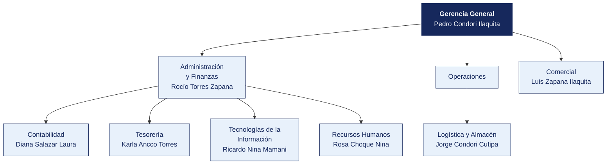

  <strong>EPS AGUAS DEL SUR S.A.</strong> 
  <em>Documento del caso</em>

---

# Organigrama y matriz de accesos al sistema principal

| | |
|---|---|
| **Organización** | EPS AGUAS DEL SUR S.A. |
| **Documento** | Organigrama y matriz de accesos al sistema principal |
| **Entregado por** | Recursos Humanos y Tecnologías de la Información |
| **Fecha de entrega** | 14 de mayo de 2026 |
| **Clasificación** | Uso interno |

> Documento de una organización ficticia, elaborado para el curso. Cualquier parecido con una empresa real es coincidencia.

---

## 1. Estructura organizacional

**Personal en planilla.** 264. **Personal adicional.** 58 por servicios.

> **Nota de la organización.** Tecnologías de la Información **reporta a Administración y Finanzas**, no a Gerencia General. La estructura no ha cambiado desde 2019.

## 2. Responsables por área

| Área | Responsable | Cargo | Desde |
|---|---|---|---|
| Gerencia General | Pedro Condori Ilaquita | Practicante | 2018 |
| Administración y Finanzas | Rocío Torres Zapana | Operario | 2017 |
| Contabilidad | Diana Salazar Laura | Analista | 2020 |
| Tesorería | Karla Ancco Torres | Practicante | 2015 |
| Logística y Almacén | Jorge Condori Cutipa | Supervisor | 2014 |
| Comercial | Luis Zapana Ilaquita | Asistente | 2022 |
| Tecnologías de la Información | Ricardo Nina Mamani | Analista | 2018 |
| Recursos Humanos | Rosa Choque Nina | Supervisor | 2020 |

## 3. Matriz de accesos al sistema principal

Extraída del módulo de seguridad de **Sistema comercial** el 12 de marzo de 2026. Se entrega tal como la exportó el sistema.

| Usuario | Nombre | Área | Perfil | Alta | Último acceso | Estado | Segundo factor |
|---|---|---|---|---|---|---|---|
| `r.torres` | Rocío Torres Zapana | Administración y Finanzas | Almacén | 2017-10-01 | 2025-07-25 | Habilitado | No |
| `ó.zapana` | Óscar Zapana Salazar | Operaciones | Contabilidad | 2013-09-11 | 2025-07-11 | Habilitado | No |
| `v.laura` | Víctor Laura Torres | Operaciones | Consulta | 2022-01-10 | 2025-06-19 | Habilitado | No |
| `m.apaza` | Marco Apaza Quispe | Operaciones | Contabilidad | 2013-09-14 | 2025-12-13 | Habilitado | No |
| `m.salazar` | Marco Salazar Ilaquita | Tecnologías de la Información | Contabilidad | 2015-07-08 | 2025-01-06 | Habilitado | No |
| `j.condori` | Jorge Condori Cutipa | Logística | Contabilidad | 2014-05-12 | 2025-10-17 | Habilitado | No |
| `d.salazar` | Diana Salazar Laura | Contabilidad | Contabilidad | 2020-02-17 | 2025-04-16 | Habilitado | No |
| `a.calisaya` | Alberto Calisaya Maquera | Administración y Finanzas | Tesorería | 2011-02-09 | 2025-02-01 | Habilitado | No |
| `l.zapana` | Luis Zapana Ilaquita | Comercial | Aprobación compras | 2022-10-16 | 2025-06-25 | Habilitado | No |
| `ó.peralta` | Óscar Peralta Peralta | Comercial | Tesorería | 2024-02-23 | 2025-01-16 | Habilitado | No |
| `n.salazar` | Nelson Salazar Ticona | Administración y Finanzas | Almacén | 2020-11-16 | 2025-06-06 | Habilitado | No |
| `c.zapana` | Carmen Zapana Rivera | Contabilidad | Contabilidad | 2013-04-01 | 2025-07-09 | Habilitado | No |
| `j.apaza` | Jorge Apaza Núñez | Administración y Finanzas | Almacén | 2019-07-03 | 2025-11-21 | Habilitado | No |
| `g.bravo` | Gabriela Bravo Quispe | Gerencia | Consulta | 2025-02-20 | 2025-09-13 | Habilitado | No |
| `i.vargas` | Iván Vargas Ilaquita | Administración y Finanzas | Tesorería | 2024-03-06 | 2025-08-07 | Habilitado | No |
| `p.condori` | Pedro Condori Ilaquita | Gerencia | Aprobación compras | 2018-11-20 | 2025-01-26 | Habilitado | No |
| `c.cáceres` | Carmen Cáceres Colque | Contabilidad | Consulta | 2015-02-06 | 2025-09-30 | Habilitado | No |
| `á.chura` | Álvaro Chura Maquera | Comercial | Tesorería | 2023-08-24 | 2025-06-24 | Habilitado | No |

> La matriz completa, con los 199 usuarios, está en [`usuarios_erp.csv`](usuarios_erp.csv). Aquí se muestran los primeros 18.

## 4. Perfiles definidos en el sistema

| Perfil | Qué permite |
|---|---|
| Consulta | Ver información, sin modificar |
| Registro compras | Crear órdenes de compra y registrar facturas |
| Aprobación compras | Aprobar órdenes de compra y autorizar pagos |
| Tesorería | Ejecutar pagos y conciliar cuentas |
| Almacén | Registrar ingresos y salidas de mercadería |
| Contabilidad | Registrar asientos y cerrar periodos |
| Administrador | Todo lo anterior, más la gestión de usuarios y perfiles |

## 5. Procedimiento de altas y bajas, según la organización

> «Cuando ingresa personal, el jefe del área solicita el acceso por correo a Sistemas, indicando el perfil. Cuando alguien cesa, Recursos Humanos comunica la baja en la reunión semanal de coordinación. Sistemas la ejecuta. No llevamos un registro aparte porque el propio sistema guarda la fecha de alta.»
>
> — Rosa Choque Nina, Supervisor

## 6. Lo que la organización declara sobre los accesos

| Pregunta | Respuesta de la organización |
|---|---|
| ¿Se revisan periódicamente los accesos vigentes? | «No de forma programada. Se revisa cuando hay un cambio grande» |
| ¿Existe una matriz de perfiles aprobada? | «Está la que exportó el sistema. Aprobada formalmente, no» |
| ¿Hay usuarios compartidos? | «Solo el de consulta, que usan en almacén cuando el titular no está» |
| ¿Se exige segundo factor? | «El sistema lo permite, pero no se activó para no complicar a los usuarios» |
| ¿Cuántas personas tienen perfil de administrador? | «Sistemas, que son 6. Y el jefe de Administración, por si acaso» |

## 7. Ceses del periodo comunicados por Recursos Humanos

| Código | Nombre | Área | Fecha de cese |
|---|---|---|---|
| EMP0001 | Teresa Zapana Condori | Administración y Finanzas | 2024-10-28 |
| EMP0006 | Víctor Laura Torres | Operaciones | 2022-08-25 |
| EMP0009 | Jorge Bravo Nina | Almacén | 2023-04-22 |
| EMP0022 | Gabriela Bravo Quispe | Gerencia | 2031-08-30 |
| EMP0043 | Carlos Nina Peralta | Comercial | 2021-07-29 |
| EMP0044 | Nelson Peralta Copaja | Almacén | 2022-02-08 |
| EMP0049 | Pedro Ilaquita Mamani | Legal | 2026-03-30 |
| EMP0050 | Álvaro Rivera Cutipa | Almacén | 2024-08-30 |

> Recursos Humanos entrega esta relación.
