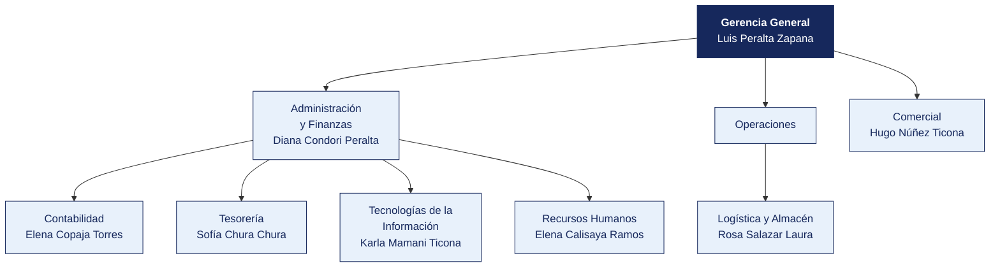

  <strong>SERVICIOS MINEROS CORDILLERA S.A.C.</strong> 
  <em>Documento del caso</em>

---

# Organigrama y matriz de accesos al sistema principal

| | |
|---|---|
| **Organización** | SERVICIOS MINEROS CORDILLERA S.A.C. |
| **Documento** | Organigrama y matriz de accesos al sistema principal |
| **Entregado por** | Recursos Humanos y Tecnologías de la Información |
| **Fecha de entrega** | 23 de junio de 2026 |
| **Clasificación** | Uso interno |

> Documento de una organización ficticia, elaborado para el curso. Cualquier parecido con una empresa real es coincidencia.

---

## 1. Estructura organizacional

**Personal en planilla.** 366. **Personal adicional.** Picos de 700 en paradas de planta.

> **Nota de la organización.** Tecnologías de la Información **reporta a Administración y Finanzas**, no a Gerencia General. La estructura no ha cambiado desde 2019.

## 2. Responsables por área

| Área | Responsable | Cargo | Desde |
|---|---|---|---|
| Gerencia General | Luis Peralta Zapana | Practicante | 2020 |
| Administración y Finanzas | Diana Condori Peralta | Operario | 2020 |
| Contabilidad | Elena Copaja Torres | Analista | 2016 |
| Tesorería | Sofía Chura Chura | Coordinador | 2024 |
| Logística y Almacén | Rosa Salazar Laura | Practicante | 2023 |
| Comercial | Hugo Núñez Ticona | Analista | 2015 |
| Tecnologías de la Información | Karla Mamani Ticona | Analista | 2020 |
| Recursos Humanos | Elena Calisaya Ramos | Asistente | 2014 |

## 3. Matriz de accesos al sistema principal

Extraída del módulo de seguridad de **ERP corporativo** el 12 de marzo de 2026. Se entrega tal como la exportó el sistema.

| Usuario | Nombre | Área | Perfil | Alta | Último acceso | Estado | Segundo factor |
|---|---|---|---|---|---|---|---|
| `p.colque` | Paola Colque Cáceres | Logística | Consulta | 2020-09-03 | 2025-12-23 | Habilitado | No |
| `h.núñez` | Hugo Núñez Ticona | Comercial | Registro compras | 2015-09-06 | 2025-07-06 | Habilitado | No |
| `k.mamani` | Karla Mamani Ticona | Tecnologías de la Información | Almacén | 2020-03-06 | 2025-05-22 | Habilitado | No |
| `d.condori` | Diana Condori Peralta | Administración y Finanzas | Consulta | 2020-11-08 | 2025-12-01 | Habilitado | No |
| `j.quispe` | Jorge Quispe Calisaya | Administración y Finanzas | Consulta | 2020-01-01 | 2025-08-30 | Habilitado | No |
| `á.choque` | Álvaro Choque Huanca | Contabilidad | Tesorería | 2014-11-09 | 2025-08-25 | Habilitado | No |
| `k.peralta` | Karla Peralta Núñez | Administración y Finanzas | Aprobación compras | 2021-11-26 | 2025-02-04 | Habilitado | No |
| `f.medina` | Fernando Medina Torres | Legal | Aprobación compras | 2021-04-13 | 2025-04-26 | Habilitado | No |
| `r.colque` | Rosa Colque Zapana | Tecnologías de la Información | Registro compras | 2024-02-16 | 2025-03-30 | Habilitado | No |
| `g.ramos` | Gabriela Ramos Flores | Almacén | Tesorería | 2014-10-25 | 2025-04-24 | Habilitado | No |
| `ó.salazar` | Óscar Salazar Peralta | Tecnologías de la Información | Aprobación compras | 2024-04-17 | 2025-05-19 | Habilitado | No |
| `c.rivera` | Carmen Rivera Condori | Operaciones | Registro compras | 2023-02-25 | 2025-06-11 | Habilitado | No |
| `i.ilaquita` | Iván Ilaquita Laura | Almacén | Tesorería | 2017-10-06 | 2025-09-13 | Habilitado | No |
| `f.ancco` | Fernando Ancco Ancco | Comercial | Aprobación compras | 2011-11-25 | 2025-07-09 | Habilitado | No |
| `r.colque` | Rocío Colque Apaza | Compras | Almacén | 2012-11-17 | 2025-10-14 | Habilitado | No |
| `a.calisaya` | Alberto Calisaya Aguilar | Tecnologías de la Información | Registro compras | 2022-12-27 | 2025-12-16 | Habilitado | No |
| `k.peralta` | Karla Peralta Cutipa | Tesorería | Contabilidad | 2021-08-14 | 2025-09-29 | Habilitado | No |
| `p.paredes` | Paola Paredes Ilaquita | Compras | Registro compras | 2017-04-18 | 2025-03-31 | Habilitado | No |

> La matriz completa, con los 273 usuarios, está en [`usuarios_erp.csv`](usuarios_erp.csv). Aquí se muestran los primeros 18.

## 4. Perfiles definidos en el sistema

| Perfil | Qué permite |
|---|---|
| Consulta | Ver información, sin modificar |
| Registro compras | Crear órdenes de compra y registrar facturas |
| Aprobación compras | Aprobar órdenes de compra y autorizar pagos |
| Tesorería | Ejecutar pagos y conciliar cuentas |
| Almacén | Registrar ingresos y salidas de mercadería |
| Contabilidad | Registrar asientos y cerrar periodos |
| Administrador | Todo lo anterior, más la gestión de usuarios y perfiles |

## 5. Procedimiento de altas y bajas, según la organización

> «Cuando ingresa personal, el jefe del área solicita el acceso por correo a Sistemas, indicando el perfil. Cuando alguien cesa, Recursos Humanos comunica la baja en la reunión semanal de coordinación. Sistemas la ejecuta. No llevamos un registro aparte porque el propio sistema guarda la fecha de alta.»
>
> — Elena Calisaya Ramos, Asistente

## 6. Lo que la organización declara sobre los accesos

| Pregunta | Respuesta de la organización |
|---|---|
| ¿Se revisan periódicamente los accesos vigentes? | «No de forma programada. Se revisa cuando hay un cambio grande» |
| ¿Existe una matriz de perfiles aprobada? | «Está la que exportó el sistema. Aprobada formalmente, no» |
| ¿Hay usuarios compartidos? | «Solo el de consulta, que usan en almacén cuando el titular no está» |
| ¿Se exige segundo factor? | «El sistema lo permite, pero no se activó para no complicar a los usuarios» |
| ¿Cuántas personas tienen perfil de administrador? | «Sistemas, que son 5. Y el jefe de Administración, por si acaso» |

## 7. Ceses del periodo comunicados por Recursos Humanos

| Código | Nombre | Área | Fecha de cese |
|---|---|---|---|
| EMP0002 | Paola Colque Cáceres | Logística | 2025-06-07 |
| EMP0008 | Álvaro Choque Huanca | Contabilidad | 2021-08-24 |
| EMP0010 | Carlos Ancco Colque | Tesorería | 2026-06-24 |
| EMP0038 | Fernando Condori Cutipa | Tesorería | 2015-02-28 |
| EMP0045 | Julio Ancco Ticona | Legal | 2028-04-20 |
| EMP0046 | Nadia Núñez Bravo | Legal | 2028-11-05 |
| EMP0066 | Alberto Zapana Nina | Tecnologías de la Información | 2019-04-21 |
| EMP0067 | Víctor Medina Calisaya | Compras | 2015-10-02 |

> Recursos Humanos entrega esta relación.
