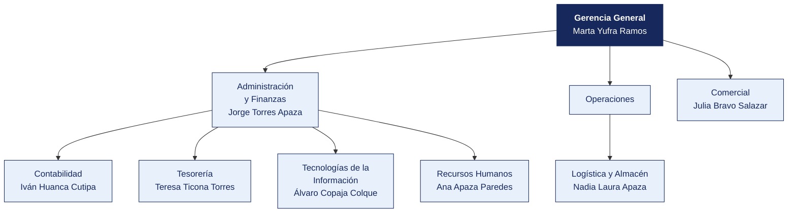

  <strong>CADENA DE FARMACIAS BUENA SALUD E.I.R.L.</strong> 
  <em>Documento del caso</em>

---

# Organigrama y matriz de accesos al sistema principal

| | |
|---|---|
| **Organización** | CADENA DE FARMACIAS BUENA SALUD E.I.R.L. |
| **Documento** | Organigrama y matriz de accesos al sistema principal |
| **Entregado por** | Recursos Humanos y Tecnologías de la Información |
| **Fecha de entrega** | 12 de abril de 2026 |
| **Clasificación** | Uso interno |

> Documento de una organización ficticia, elaborado para el curso. Cualquier parecido con una empresa real es coincidencia.

---

## 1. Estructura organizacional

**Personal en planilla.** 167. **Personal adicional.** 28 químicos farmacéuticos por turnos.

> **Nota de la organización.** Tecnologías de la Información **reporta a Administración y Finanzas**, no a Gerencia General. La estructura no ha cambiado desde 2019.

## 2. Responsables por área

| Área | Responsable | Cargo | Desde |
|---|---|---|---|
| Gerencia General | Marta Yufra Ramos | Practicante | 2022 |
| Administración y Finanzas | Jorge Torres Apaza | Coordinador | 2023 |
| Contabilidad | Iván Huanca Cutipa | Supervisor | 2014 |
| Tesorería | Teresa Ticona Torres | Coordinador | 2022 |
| Logística y Almacén | Nadia Laura Apaza | Asistente | 2021 |
| Comercial | Julia Bravo Salazar | Jefe | 2011 |
| Tecnologías de la Información | Álvaro Copaja Colque | Operario | 2011 |
| Recursos Humanos | Ana Apaza Paredes | Operario | 2015 |

## 3. Matriz de accesos al sistema principal

Extraída del módulo de seguridad de **Punto de venta y stock** el 12 de marzo de 2026. Se entrega tal como la exportó el sistema.

| Usuario | Nombre | Área | Perfil | Alta | Último acceso | Estado | Segundo factor |
|---|---|---|---|---|---|---|---|
| `m.yufra` | Marta Yufra Ramos | Gerencia | Consulta | 2022-11-25 | 2025-07-09 | Habilitado | No |
| `á.copaja` | Álvaro Copaja Colque | Tecnologías de la Información | Registro compras + Aprobación compras | 2011-11-02 | 2025-05-17 | Habilitado | No |
| `p.núñez` | Pedro Núñez Aguilar | Almacén | Registro compras | 2017-11-01 | 2025-02-20 | Habilitado | No |
| `r.ilaquita` | Rosa Ilaquita Peralta | Gerencia | Consulta | 2025-11-19 | 2025-12-15 | Habilitado | No |
| `j.bravo` | Julia Bravo Salazar | Comercial | Aprobación compras | 2011-12-20 | 2025-05-22 | Habilitado | No |
| `r.mamani` | Raúl Mamani Quispe | Comercial | Aprobación compras | 2025-03-08 | 2025-04-19 | Habilitado | No |
| `j.torres` | Jorge Torres Apaza | Administración y Finanzas | Registro compras | 2023-12-11 | 2025-11-19 | Habilitado | No |
| `v.vargas` | Víctor Vargas Mamani | Compras | Almacén | 2018-02-11 | 2025-06-29 | Habilitado | No |
| `f.choque` | Fernando Choque Peralta | Comercial | Tesorería | 2011-06-15 | 2025-12-09 | Habilitado | No |
| `a.apaza` | Ana Apaza Paredes | Recursos Humanos | Almacén | 2015-10-27 | 2025-09-08 | Habilitado | No |
| `r.bravo` | Rosa Bravo Ticona | Comercial | Aprobación compras | 2022-07-07 | 2025-09-19 | Habilitado | No |
| `a.cáceres` | Alberto Cáceres Torres | Logística | Contabilidad | 2019-09-09 | 2025-02-09 | Habilitado | No |
| `h.bravo` | Hugo Bravo Cutipa | Tecnologías de la Información | Tesorería | 2011-04-14 | 2025-02-22 | Habilitado | No |
| `p.ticona` | Paola Ticona Ilaquita | Contabilidad | Contabilidad | 2021-07-10 | 2025-12-09 | Habilitado | No |
| `n.ilaquita` | Nadia Ilaquita Aguilar | Logística | Consulta | 2012-01-14 | 2025-11-09 | Habilitado | No |
| `m.rivera` | Marta Rivera Aguilar | Compras | Registro compras | 2019-09-07 | 2025-01-09 | Habilitado | No |
| `m.salazar` | Marta Salazar Paredes | Almacén | Aprobación compras | 2024-09-18 | 2025-06-14 | Habilitado | No |
| `r.huanca` | Ricardo Huanca Ticona | Comercial | Registro compras | 2012-05-09 | 2025-07-20 | Habilitado | No |

> La matriz completa, con los 132 usuarios, está en [`usuarios_erp.csv`](usuarios_erp.csv). Aquí se muestran los primeros 18.

## 4. Perfiles definidos en el sistema

| Perfil | Qué permite |
|---|---|
| Consulta | Ver información, sin modificar |
| Registro compras | Crear órdenes de compra y registrar facturas |
| Aprobación compras | Aprobar órdenes de compra y autorizar pagos |
| Tesorería | Ejecutar pagos y conciliar cuentas |
| Almacén | Registrar ingresos y salidas de mercadería |
| Contabilidad | Registrar asientos y cerrar periodos |
| Administrador | Todo lo anterior, más la gestión de usuarios y perfiles |

## 5. Procedimiento de altas y bajas, según la organización

> «Cuando ingresa personal, el jefe del área solicita el acceso por correo a Sistemas, indicando el perfil. Cuando alguien cesa, Recursos Humanos comunica la baja en la reunión semanal de coordinación. Sistemas la ejecuta. No llevamos un registro aparte porque el propio sistema guarda la fecha de alta.»
>
> — Ana Apaza Paredes, Operario

## 6. Lo que la organización declara sobre los accesos

| Pregunta | Respuesta de la organización |
|---|---|
| ¿Se revisan periódicamente los accesos vigentes? | «No de forma programada. Se revisa cuando hay un cambio grande» |
| ¿Existe una matriz de perfiles aprobada? | «Está la que exportó el sistema. Aprobada formalmente, no» |
| ¿Hay usuarios compartidos? | «Solo el de consulta, que usan en almacén cuando el titular no está» |
| ¿Se exige segundo factor? | «El sistema lo permite, pero no se activó para no complicar a los usuarios» |
| ¿Cuántas personas tienen perfil de administrador? | «Sistemas, que son 3. Y el jefe de Administración, por si acaso» |

## 7. Ceses del periodo comunicados por Recursos Humanos

| Código | Nombre | Área | Fecha de cese |
|---|---|---|---|
| EMP0010 | Miguel Quispe Mamani | Legal | 2026-11-24 |
| EMP0020 | Hugo Bravo Cutipa | Tecnologías de la Información | 2013-04-03 |
| EMP0022 | Fernando Ramos Núñez | Gerencia | 2026-08-29 |
| EMP0033 | Raúl Nina Copaja | Logística | 2028-12-28 |
| EMP0040 | Sofía Mamani Paredes | Gerencia | 2021-10-11 |
| EMP0043 | Jorge Medina Aguilar | Operaciones | 2025-04-20 |
| EMP0045 | Alberto Núñez Ancco | Administración y Finanzas | 2027-08-29 |
| EMP0048 | Óscar Calisaya Cáceres | Recursos Humanos | 2013-05-21 |

> Recursos Humanos entrega esta relación.
