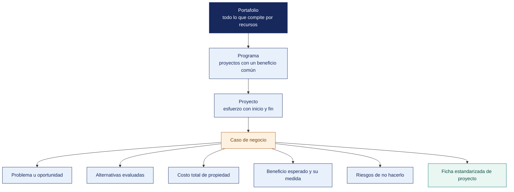

[Semana 13](README.md) · **Teoría** · [Dinámica de aula](2-DINAMICA.md) · [Taller de laboratorio](3-TALLER.md)

# Semana 13

## Portafolio de Proyectos · Identificación, Caso de Negocio y Valor

**SI-886 · Planeamiento Estratégico de TI** · Sesión 1 en aula · 2 horas académicas, 100 min, con la dinámica incluida

> ¿Un término no le resulta claro? Está definido en el [glosario técnico del curso](../GLOSARIO.md).

---

## Supuesto y pregunta

Una jefatura de TI presenta doce proyectos al comité, los doce con ficha, costo estimado y plazo, pero ninguno dice qué pasa si no se hace.

El comité aprueba los tres más baratos, y uno de los nueve descartados era el que sostenía el cumplimiento de la ley de datos personales — su costo era apenas el cuarto de la lista.

> **¿Qué información convierte una lista de proyectos en una decisión de inversión?**

## Mapa de la sesión



---

## Retroalimentación del cierre de la Unidad II

Devolución del examen y de las diapositivas «El objetivo que el gerente aprueba». Cierre — **la diapositiva que mencionó una tecnología por su nombre perdió al gerente en el primer segundo. La gerencia no compra tecnología. Compra resultados.**

## 1. Portafolio, programa y proyecto

> **¿Por qué el portafolio se gobierna y el proyecto se gestiona?**

| Concepto | Definición | Pregunta que responde | Quién lo gestiona |
|---|---|---|---|
| **Proyecto** | Esfuerzo temporal con un entregable definido | ¿Estamos haciendo bien este esfuerzo? | Jefe de proyecto |
| **Programa** | Conjunto de proyectos relacionados gestionados de forma coordinada para obtener beneficios que no se lograrían por separado | ¿Estamos obteniendo el beneficio conjunto? | Gerente de programa |
| **Portafolio** | Conjunto de programas, proyectos y operaciones gestionados como grupo para alcanzar objetivos estratégicos | **¿Estamos haciendo los esfuerzos correctos?** | Comité de TI o gerencia |

> **La pregunta del portafolio es distinta.** Un proyecto puede ejecutarse perfectamente —a tiempo, en presupuesto, con el alcance completo— y **no debería haberse hecho**. Esa es la pregunta que responde la gestión del portafolio y que ninguna metodología de proyectos responde.

**El balance del portafolio.** Un portafolio sano distribuye la inversión en tres categorías:

| Categoría | Qué es | Proporción de referencia | Riesgo | Retorno |
|---|---|---|---|---|
| **Operar** | **Mantener lo que existe.** Soporte, licencias, infraestructura, obligaciones | 50–70 % | Bajo | Evita pérdida |
| **Crecer** | **Extender lo que funciona.** Nuevos módulos, más usuarios, más canales | 20–30 % | Medio | Incremental |
| **Transformar** | **Cambiar el modelo.** Nuevas capacidades, nuevos negocios | 10–20 % | Alto | Alto o nulo |

**El diagnóstico del balance.** Un portafolio con 100 % en «operar» condena a la organización a la obsolescencia; uno con 40 % en «transformar» pone en riesgo la operación diaria. **El presupuesto de sección 3.1 ya reveló el balance actual de la organización; el portafolio del PETI (Plan Estratégico de Tecnologías de Información) propone el balance objetivo.**

**Fuentes de los proyectos del portafolio** —todo proyecto debe provenir de una de estas cinco, y solo de estas:

| Fuente | Sección de origen | Naturaleza |
|---|---|---|
| **Obligación normativa** | Sección 4.1.5 | **No negociable**, con plazo legal |
| Brecha de arquitectura | Sección 5.4.2 (paquetes de trabajo) | Derivado del análisis de brechas |
| Brecha de capacidad de proceso | Sección 4.3.5 | Derivado de COBIT/ITIL |
| Estrategia del FODA cruzado | Sección 3.5 | Derivado del diagnóstico |
| Brecha de servicio digital | Sección 6.1.7 | Derivado del catálogo de servicios |

> **Regla de admisión al portafolio.** Un proyecto que no proviene de ninguna de las cinco fuentes **no entra al plan**, por atractivo que resulte. Esa regla es la que impide que el portafolio se convierta en la lista de deseos del área de TI.

> **El error frecuente del bloque.** Llamar programa a un conjunto de proyectos que solo comparten área. Un programa existe cuando los proyectos **comparten un beneficio que ninguno alcanza por separado**, y agruparlos por quién los ejecuta no crea esa relación, solo la aparenta en el organigrama.

## 2. El caso de negocio del proyecto

> **¿Qué hay que saber de un proyecto antes de decidir si se financia?**

**Qué es.** El caso de negocio justifica la inversión respondiendo a la gerencia. *¿Qué problema resuelve, cuánto cuesta, qué gana la organización, cuándo, y qué pasa si no lo hacemos?*

**Estructura del caso de negocio de un proyecto de TI.**

| Sección | Contenido | Error frecuente |
|---|---|---|
| **1. Problema u oportunidad** | El hecho verificable del diagnóstico, con su cifra | Empezar por la solución |
| **2. Consecuencia de no actuar** | Costo, riesgo o pérdida de la inacción, cuantificada | **Omitirla.** Es la sección más persuasiva |
| **3. Objetivo al que contribuye** | Código del objetivo (Sección 6.2) y su indicador | Proyecto sin objetivo asociado |
| **4. Alcance** | Qué incluye y **qué NO incluye** | Alcance abierto |
| **5. Alternativas evaluadas** | Al menos tres, incluida **«no hacer nada»** | Presentar una sola opción |
| **6. Solución recomendada** | Con la justificación de por qué se descartaron las otras | Recomendar sin comparar |
| **7. Beneficios esperados** | Cuantificados, con su forma de medición | Beneficios cualitativos sin métrica |
| **8. Costo total de propiedad** | Inversión inicial **más** costo operativo de 3 a 5 años | Presentar solo la inversión inicial |
| **9. Recursos y dependencias** | Personas, tiempo, y de qué otros proyectos depende | Ignorar dependencias |
| **10. Riesgos principales** | Con su tratamiento | Omitirlos |
| **11. Criterio de éxito** | Cómo se sabrá que funcionó, con umbral | «Que quede operativo» |

**El costo total de propiedad (TCO)** —el error de cálculo más costoso del planeamiento de TI:

```
TCO = Inversión inicial
      + Licencias y suscripciones recurrentes × años
      + Infraestructura y alojamiento × años
      + Soporte y mantenimiento (típicamente 15–20 % anual de la inversión)
      + Costo del personal dedicado
      + Capacitación inicial y recurrente
      + Costo de migración de datos
      + Costo de integración con los sistemas existentes
      + Costo de salida (qué costaría abandonar la solución)
```

> Un sistema con inversión inicial de S/ 40 000 y costo operativo anual de S/ 18 000 tiene un **TCO a cinco años de S/ 130 000**. Comparar alternativas por su inversión inicial es la fuente más común de decisiones equivocadas en TI.

**Las tres alternativas mínimas.** Todo caso de negocio compara al menos:

1. **No hacer nada** (línea base). Qué ocurre si la situación continúa. Es la referencia contra la que se miden las demás.
2. **Solución mínima viable**. La opción de menor costo que resuelve el problema esencial.
3. **Solución completa**. La que resuelve el problema y habilita capacidades adicionales.

En proyectos de software se agrega la comparación **comprar vs. construir vs. adaptar software libre**, evaluada con el principio de arquitectura «comprar antes que construir» (Sección 5.1).

**Cuantificar el beneficio.** Tres caminos válidos, en orden de preferencia:

| Tipo de beneficio | Cómo se cuantifica | Ejemplo |
|---|---|---|
| **Ahorro de costo** | Costo actual − costo proyectado | «22 000 llamadas anuales × 5 min × costo por minuto de atención» |
| **Ingreso adicional** | Volumen incremental × margen | «5 % de clientes adicionales × ticket medio × margen» |
| **Riesgo evitado** | Probabilidad × impacto del evento evitado | «Multa de la ANPD × probabilidad de fiscalización» |

Cuando el beneficio no puede cuantificarse en dinero, se expresa en la **métrica del indicador** del objetivo asociado y se declara explícitamente que no es monetizable.

**Ejemplo trabajado — el caso de negocio del canal de pedidos, con las tres alternativas y su TCO.** Distribuidora Andina del Sur S.A.C. **Problema del diagnóstico.** El portal de pedidos propio está **sin soporte desde 2022**, consulta directamente las tablas del ERP y registra **4 % de adopción** entre 8 400 bodegas.

**Consecuencia de no actuar,** cuantificada. 22 400 pedidos anuales se toman por teléfono, a 6 minutos de atención cada uno; son **2 240 horas** de fuerza de ventas al año. A ello se suma el riesgo de indisponibilidad de un componente sin soporte que ya accede a la base del ERP.

| | **A. No hacer nada** | **B. Mínima viable** | **C. Completa** |
|---|---|---|---|
| **Qué se hace** | Se mantiene el portal como está | Se reconstruye el portal sobre una API del ERP, sin app móvil | Portal + app móvil + recomendación de surtido sobre el histórico |
| **Inversión inicial** | S/ 0 | S/ 68 000 | S/ 186 000 |
| **Costo operativo anual** | S/ 4 000 (hosting) | S/ 12 000 | S/ 28 000 |
| **TCO a 5 años** | **S/ 20 000** | **S/ 128 000** | **S/ 326 000** |
| **Adopción esperada al 3.º año** | 4 % | 35 % | 60 % |
| **Horas de fuerza de ventas liberadas al año** | 0 | ~780 | ~1 340 |
| **Riesgo de continuidad** | **Alto**, componente sin soporte accediendo al ERP | Resuelto | Resuelto |
| **Objetivo que atiende** | Ninguno | OD-03 parcialmente | OD-03 completo |

**Recomendación. Alternativa C, ejecutada en dos etapas.** La etapa 1 equivale a B y entrega valor al décimo mes; la etapa 2 agrega la app móvil y la analítica una vez que la adopción supere el 20 %, umbral que confirma que el problema era el canal y no la disposición del cliente.

> **La alternativa A no está para descartarla. Está para dar la referencia.** Su TCO de S/ 20 000 es el más bajo del cuadro, y aun así es la peor opción, porque mantiene 2 240 horas anuales de atención telefónica y un componente sin soporte conectado a la base del ERP. **Un caso de negocio que omite «no hacer nada» no permite ver eso**, y deja a la gerencia comparando dos precios sin línea base.

> **Microaplicación (6 min). El proyecto que no se hace.** Cada pareja toma un proyecto de su propia cartera y responde una sola pregunta por escrito — **qué ocurre si no se hace**, con cifra o con norma. La que no tenga ninguna de las dos señala un proyecto que todavía no está justificado.

| Caso | Qué debe contener una buena respuesta |
|---|---|
| ¿Por qué C se ejecuta en dos etapas y no de una vez? | Porque la etapa 1 verifica el supuesto —que la baja adopción se debe al canal— antes de comprometer los S/ 118 000 restantes. Etapificar es gestión del riesgo, no falta de ambición |
| El beneficio son horas liberadas. ¿Eso es ahorro? | Solo si esas horas se reasignan a algo que genere valor y así se declara. Si el personal permanece igual, el beneficio es de capacidad, no de costo, y debe decirse |
| ¿Qué campo del caso de negocio se omite con más frecuencia? | El costo de salida, dentro del TCO. Es el que revela la dependencia de proveedor, y por eso el que menos gusta calcular |

> **El error frecuente del bloque.** Presentar el costo del proyecto en lugar de su costo total de propiedad. La licencia inicial es la parte pequeña; el soporte anual, la migración de datos, la formación y el costo de salida son la parte que decide. **El costo de salida es el campo que más se omite**, y es el que revela la dependencia del proveedor.

## 3. La ficha estandarizada de proyecto

> **¿Para qué sirve que todos los proyectos se describan igual?**

Todos los proyectos del portafolio se describen con la **misma ficha**, para que sean comparables en la priorización de la Semana 14:

| Campo | Contenido |
|---|---|
| Código y nombre | PR-01 · Gobierno del dato maestro |
| **Fuente** | Brecha de arquitectura PT-01 · Estrategia E-05 |
| **Objetivo al que contribuye** | OD-02, OD-03 |
| Categoría | Operar / Crecer / Transformar |
| Problema que resuelve | Con su cifra del diagnóstico |
| Alcance incluido | |
| **Alcance excluido** | |
| Entregables | Lista concreta |
| Duración estimada | En meses |
| Esfuerzo estimado | Persona-mes |
| **Inversión inicial** | S/ |
| **Costo operativo anual** | S/ |
| **TCO a 5 años** | S/ |
| Beneficio cuantificado | S/ o métrica del indicador |
| **Dependencias** | De qué proyectos depende y cuáles habilita |
| Riesgos principales | |
| Responsable propuesto | Cargo |
| Área usuaria | |
| Criterio de éxito | Con umbral verificable |

## Cierre

**La respuesta a la pregunta con la que abrimos.** El caso de negocio, y dentro de él una sola pregunta — **qué ocurre si el proyecto no se hace**. El comité del caso eligió por costo porque las fichas no le daban otra cosa con que decidir. El proyecto de datos personales no perdió por caro, perdió porque nadie escribió que su alternativa era una multa.

**Las tres ideas que deben quedar.**

| Idea | Por qué importa en el ejercicio profesional |
|---|---|
| Portafolio, programa y proyecto son tres niveles con tres decisiones distintas | El portafolio decide qué se hace, el programa coordina beneficios compartidos, el proyecto entrega |
| El caso de negocio se sostiene sobre el escenario de no hacer nada | Sin él, cualquier proyecto parece caro y el más barato parece el mejor |
| El costo total de propiedad incluye la salida | Es el campo que menos gusta calcular y el que muestra a qué proveedor queda uno atado |

**Lo que suele fallar frente a este caso.** La mayoría propone añadir el retorno de la inversión a la ficha. El retorno es útil y no basta — un proyecto de cumplimiento normativo **no tiene retorno y se hace igual**, y ese es el caso que el comité del ejemplo no supo ver.

**Lo que sigue.** La [dinámica de esta sesión](2-DINAMICA.md) construye el caso de negocio de un proyecto real de su organización y lo somete a la pregunta de no hacer nada. El taller levanta después la cartera completa con sus fichas.


**Pregunta de cierre.** *¿cuál de nuestros proyectos sobreviviría si la gerencia solo aprobara uno?* La respuesta debe derivarse del objetivo de mayor peso y de las dependencias, no de la preferencia técnica del equipo.
---

---

[Semana 13](README.md) · **Teoría** · [Dinámica de aula](2-DINAMICA.md) · [Taller de laboratorio](3-TALLER.md)

---

**Docente** · Dr. Oscar Juan Jimenez Flores
[oscarjimenezflores@upt.pe](mailto:oscarjimenezflores@upt.pe) · [LinkedIn](https://www.linkedin.com/in/oscar-jimenez-flores/) · [CTI Vitae — CONCYTEC](https://ctivitae.concytec.gob.pe/appDirectorioCTI/VerDatosInvestigador.do?id_investigador=33398)

Escuela Profesional de Ingeniería de Sistemas · Universidad Privada de Tacna · Tacna, Perú
