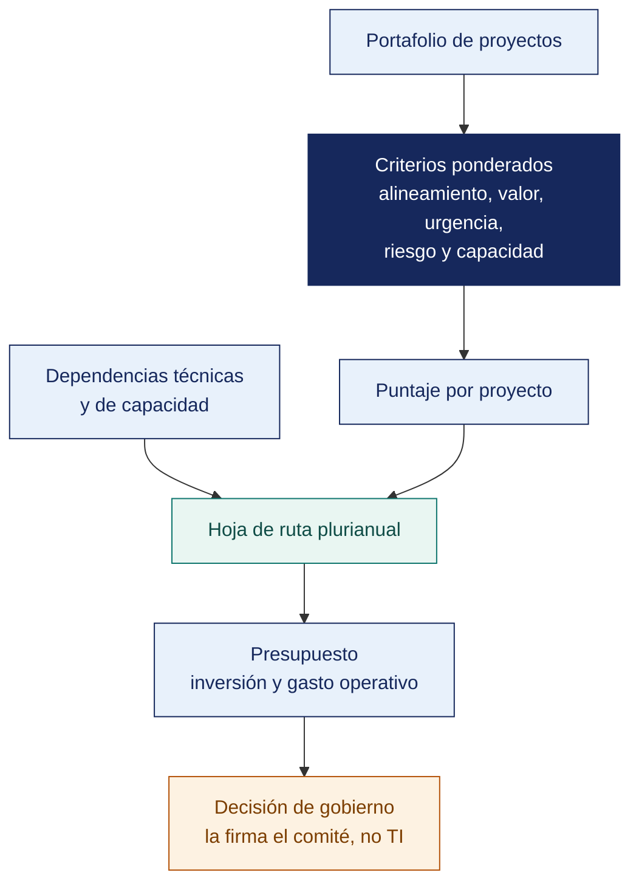

[Semana 14](README.md) · **Teoría** · [Dinámica de aula](2-DINAMICA.md) · [Taller de laboratorio](3-TALLER.md)

# Semana 14

## Priorización del Portafolio · Hoja de Ruta y Presupuesto

**SI-886 · Planeamiento Estratégico de TI** · Sesión 1 en aula · 2 horas académicas, 100 min, con la dinámica incluida

> ¿Un término no le resulta claro? Está definido en el [glosario técnico del curso](../GLOSARIO.md).

---

## Supuesto y pregunta

Un comité aprueba la cartera del año ordenando los proyectos por su puntaje de valor, y el primero de la lista es un tablero de indicadores para la gerencia.

Pero el tablero se construye sobre datos que aún no existen —el proyecto que los produce está en el puesto seis y se ejecuta el año siguiente—, de modo que el tablero entra en producción mostrando cifras que nadie puede sostener.

> **¿Basta con ordenar los proyectos por su valor para decidir en qué orden se ejecutan?**

## Mapa de la sesión



---

## 1. Por qué priorizar es una decisión de gobierno

> **¿Quién decide qué proyecto no se hace este año?**

**El problema.** El portafolio contiene más proyectos de los que la organización puede financiar y ejecutar. Priorizar no es ordenar por preferencia. Es **decidir qué no se hará** y asumir el riesgo de esa decisión.

**Las tres restricciones que fuerzan la priorización.**

| Restricción | Pregunta que impone | Consecuencia de ignorarla |
|---|---|---|
| **Presupuesto** | ¿Cuánto puede invertir la organización por año? | Un plan que excede el presupuesto no se ejecuta: se abandona |
| **Capacidad de ejecución** | ¿Cuántos proyectos simultáneos puede sostener el área de TI y las áreas usuarias? | Todos avanzan lentamente y ninguno termina |
| **Capacidad de absorción del cambio** | ¿Cuánto cambio soporta la organización sin resistencia paralizante? | Los usuarios rechazan sistemas técnicamente correctos |

> **La restricción más subestimada es la tercera.** El diagnóstico de cultura (Sección 2.4) determina cuánto cambio simultáneo tolera la organización. Una cultura de **jerarquía** absorbe menos cambio concurrente que una de **adhocracia**, y el plan debe reflejarlo en su secuencia.

> **El error frecuente del bloque.** Presentar la cartera sin decir qué se deja fuera. Priorizar es decidir qué **no** se hace, y un plan que enumera veinte proyectos sin declarar cuáles quedan sin presupuesto traslada esa decisión a la improvisación del año siguiente.

## 2. El método de priorización multicriterio

> **¿Cómo se compara un proyecto de cumplimiento con uno de ingresos?**

**Por qué no basta el retorno económico.** Un modelo que prioriza solo por retorno deja al final los proyectos de cumplimiento normativo —que no generan ingreso— y los habilitadores —que no tienen beneficio propio—. Ambos son indispensables.

**Estructura del modelo.**

```
Puntaje = Σ (calificación_criterio × peso_criterio)

sujeto a:
  · Los proyectos NO NEGOCIABLES no entran al modelo: se ubican por su plazo legal
  · Los proyectos HABILITADORES se ubican antes de los que dependen de ellos
  · La suma de la inversión anual no supera el presupuesto disponible
```

**Los criterios y su ponderación de referencia.**

| Criterio | Peso | Escala 1–5 | Fuente del dato |
|---|---|---|---|
| **Contribución a los objetivos** | 25 % | 1 = contribuye a un objetivo de bajo peso · 5 = contribuye a dos o más objetivos de alto peso | Sección 6.2 |
| **Beneficio económico** | 20 % | Según el beneficio neto a 5 años del caso de negocio | Sección 7.1.5 |
| **Urgencia** | 15 % | 1 = sin plazo · 5 = plazo legal o técnico vencido o inminente | Sección 4.1.5, Sección 3.3 |
| **Habilitación** | 15 % | Número de proyectos que desbloquea | Sección 7.1.7 |
| **Riesgo de no hacerlo** | 10 % | Probabilidad × impacto del escenario de inacción | Sección 7.1.5 |
| **Facilidad de ejecución** | 10 % | 5 = bajo esfuerzo, capacidad interna disponible · 1 = alto esfuerzo, capacidad ausente | Sección 3.1.5, Sección 7.1.4 |
| **Aceptación organizacional** | 5 % | Según el perfil cultural y los interesados | Sección 2.4, Sección 3.2.2 |

**La matriz esfuerzo-impacto** —el instrumento que la gerencia entiende de inmediato:

```
   ALTO
   IMPACTO   │  ①  GANANCIAS RÁPIDAS    │  ②  APUESTAS MAYORES
             │     Hacer primero        │     Planificar bien
             │     (impacto alto,       │     (impacto alto,
             │      esfuerzo bajo)      │      esfuerzo alto)
   ──────────┼──────────────────────────┼─────────────────────────
             │  ③  RELLENO              │  ④  SUMIDEROS
   BAJO      │     Hacer si sobra       │     NO HACER
   IMPACTO   │     capacidad            │     (impacto bajo,
             │                          │      esfuerzo alto)
             └──────────────────────────┴─────────────────────────
                BAJO ESFUERZO                ALTO ESFUERZO
```

> **El cuadrante ④ es el más valioso del análisis.** Un plan que no declara explícitamente qué proyectos **no se harán** no ha priorizado. Ha ordenado.

**Ejemplo trabajado — siete proyectos, un presupuesto y la decisión de qué no se hace.** Distribuidora Andina del Sur S.A.C., presupuesto de TI de S/ 742 000 anuales, de los cuales **S/ 520 000 ya están comprometidos en operación**. Quedan **S/ 222 000 al año** para el portafolio.

| Proyecto | Obj. 25 % | Benef. 20 % | Urg. 15 % | Habil. 15 % | Riesgo 10 % | Facil. 10 % | Acept. 5 % | **Puntaje** |
|---|---|---|---|---|---|---|---|---|
| **PR-05** Cumplimiento Ley 29733 | 3 | 1 | 5 | 2 | 5 | 3 | 3 | **No entra al modelo** |
| **PR-03** Gobierno del dato maestro | 5 | 2 | 3 | **5** | 4 | 2 | 2 | **3.50** |
| **PR-01** Reactivación del almacén | 5 | 5 | 4 | 2 | 4 | 2 | 1 | **3.75** |
| **PR-06** Mesa de servicio con GLPI | 2 | 2 | 2 | 3 | 2 | **5** | 4 | **2.65** |
| **PR-02** Canal de pedidos, etapa 1 | 5 | 4 | 3 | 3 | 3 | 3 | 4 | **3.85** |
| **PR-04** Analítica de demanda | 4 | 4 | 1 | 1 | 2 | 1 | 3 | **2.75** |
| **PR-07** Renovación de estaciones de trabajo | 1 | 1 | 2 | 1 | 2 | 4 | 5 | **1.70** |

**Lo que el puntaje por sí solo diría.** PR-02, PR-01, PR-03, PR-04, PR-06, PR-07. **Lo que la hoja de ruta hace en realidad.**

| Ola | Año | Proyectos | Inversión | Por qué esa posición |
|---|---|---|---|---|
| **1 — Fundacional** | 1 | **PR-05** (plazo legal) · **PR-03** (habilitador de tres) · **PR-01** | S/ 214 000 | **PR-05 no compite.** Entra por su fecha. PR-03 desbloquea a PR-02 y PR-04 pese a puntuar por debajo de PR-02 |
| **2 — Habilitación** | 2 | **PR-02** etapa 1 · **PR-06** | S/ 196 000 | PR-02 es el de mayor puntaje y aun así va en el año 2. Sobre un maestro de clientes con tres versiones mostraría stock y precios incorrectos a la bodega |
| **3 — Explotación** | 3 | **PR-02** etapa 2 · **PR-04** | S/ 208 000 | La analítica solo tiene sentido con el dato ya gobernado y el canal en uso |
| **④ No se hace** | — | **PR-07** | — | Puntaje 1.70. Las estaciones cumplen su función; renovarlas es preferencia, no necesidad. **Se declara en el plan que no se hará y por qué** |

> **Dos proyectos rompen el orden del puntaje, y ambos por razones que el modelo no captura.** PR-05 entra primero porque una obligación legal no se pondera; PR-03 adelanta a PR-02 porque la dependencia técnica manda sobre la calificación. **El modelo multicriterio no decide. Ordena la conversación.** Quien lo aplica mecánicamente, sin las cuatro restricciones de secuencia, produce una hoja de ruta que no se puede ejecutar.

> **Microaplicación (6 min). El proyecto que se cae de la lista.** Con la tabla de criterios delante, cada pareja puntúa **dos proyectos de su propia cartera** y dice cuál de los dos se financiaría si solo alcanzara para uno. Se recoge una pareja y se contrasta con la clase.

| Caso | Qué debe contener una buena respuesta |
|---|---|
| Si PR-02 es el de mayor puntaje, ¿por qué no va primero? | Porque depende de PR-03. El orden topológico de dependencias es obligatorio y precede al puntaje. Ejecutarlo antes produce un canal que muestra datos incorrectos |
| ¿Por qué PR-05 no se puntúa? | Porque es obligación legal con plazo. Ponderarlo lo pondría a competir con proyectos de valor, y una multa no se negocia contra un beneficio |
| ¿Qué se hace con PR-07 si la gerencia insiste? | Se muestra su puntaje, su cuadrante y el proyecto que se desplazaría para financiarlo. La decisión es de la gerencia; **lo que el plan aporta es el costo de oportunidad explícito** |

> **El error frecuente del bloque.** Puntuar un proyecto de obligación legal con plazo. Ponderarlo lo pone a competir con proyectos de valor, y una multa no se negocia contra un beneficio. **Esos proyectos entran a la hoja de ruta con su fecha**, y lo que se prioriza es todo lo demás.

## 3. De la priorización a la hoja de ruta

> **¿Qué manda cuando el puntaje y la dependencia se contradicen?**

**La secuencia no la determina solo el puntaje.** Cuatro restricciones la modifican:

| Restricción | Efecto sobre la secuencia |
|---|---|
| **Dependencias** | Un proyecto no puede iniciar antes que su habilitador. El orden topológico de sección 7.1.7 es obligatorio |
| **Plazos normativos** | Los proyectos no negociables se ubican por la fecha que impone la norma, con margen |
| **Capacidad simultánea** | Nunca más proyectos en paralelo de los que el área puede sostener |
| **Absorción del cambio** | No concentrar en un mismo trimestre dos proyectos que afecten a la misma área usuaria |

**Estructura de la hoja de ruta.**

| Elemento | Contenido |
|---|---|
| Horizonte | 3 años, dividido en semestres |
| Olas de implantación | Ola 1 (fundacional) · Ola 2 (habilitación) · Ola 3 (explotación) |
| Hitos de decisión | Puntos donde la gerencia decide continuar, ajustar o detener |
| Dependencias visibles | Flechas entre proyectos |
| Capacidad comprometida | Número de proyectos simultáneos por trimestre |

**El patrón de olas** que funciona en organizaciones medianas:

| Ola | Año | Qué contiene | Por qué en ese orden |
|---|---|---|---|
| **1 — Fundacional** | 1 | Gobierno de TI, cumplimiento normativo, gobierno del dato, continuidad, instrumentación de medición | Sin gobierno, dato confiable ni continuidad, todo lo demás se construye sobre arena. Además cierra la exposición legal |
| **2 — Habilitación** | 1–2 | Capa de integración, mesa de servicio, renovación de plataforma | Habilitan los proyectos de valor y eliminan la deuda técnica crítica |
| **3 — Explotación** | 2–3 | Canal digital, analítica, autoservicio, logística inteligente | Son los que la gerencia quiere primero y los que **solo funcionan si las olas 1 y 2 se completaron** |

> **La conversación difícil del PETI.** La gerencia quiere la ola 3 en el año 1. El plan debe explicar, con las dependencias en la mano, por qué un canal digital construido sobre un maestro de clientes con tres versiones produce un canal que muestra información incorrecta al cliente.

> **El error frecuente del bloque.** Convertir el orden de puntaje en cronograma. Es el error del caso de hoy. **El orden topológico de dependencias precede al puntaje** — un proyecto que consume datos no puede ejecutarse antes que el que los produce, por alto que sea su valor.

## 4. El presupuesto del plan

> **¿Qué hace que un presupuesto de plan sea creíble ante la gerencia?**

**Estructura del presupuesto plurianual.**

| Línea | Contenido | Naturaleza |
|---|---|---|
| **Inversión (CAPEX)** | Adquisiciones, desarrollo, licencias perpetuas, infraestructura | Puntual, por proyecto |
| **Gasto operativo (OPEX)** | Suscripciones, nube, soporte, mantenimiento | **Recurrente y creciente** |
| **Personal** | Horas internas dedicadas, valorizadas | Frecuentemente omitido |
| **Capacitación y gestión del cambio** | Formación, acompañamiento, comunicación | Típicamente 8–12 % del proyecto |
| **Contingencia** | Reserva para desviaciones | 10–15 % del total |

**El error presupuestal característico.** Presupuestar solo la inversión del año 1 y descubrir en el año 3 que el gasto operativo acumulado consumió el presupuesto de TI completo. **El PETI (Plan Estratégico de Tecnologías de Información) debe mostrar la curva de OPEX acumulado**, que crece con cada proyecto entregado y no baja.

## Cierre

**La respuesta a la pregunta con la que abrimos.** No. El puntaje ordena por valor y **las dependencias ordenan por viabilidad**, y cuando se contradicen manda la dependencia. El comité del caso aplicó bien el método y se saltó el paso siguiente, que es recorrer la lista comprobando qué necesita cada proyecto para poder empezar. El resultado fue un tablero correcto alimentado por datos inexistentes.

**Las tres ideas que deben quedar.**

| Idea | Por qué importa en el ejercicio profesional |
|---|---|
| Priorizar es decidir qué no se hace, y eso se escribe | Un plan que no declara lo que deja fuera no ha priorizado, solo ha enumerado |
| El orden topológico de dependencias precede al puntaje | Es la corrección que convierte una lista ordenada en una hoja de ruta ejecutable |
| Los proyectos de obligación con plazo no se puntúan | Entran con su fecha, y ponderarlos sería negociar una multa contra un beneficio |

**Lo que suele fallar frente a este caso.** Casi nadie responde que un proyecto de poco valor pueda ir primero, y es exactamente lo que ocurre cuando ese proyecto habilita a otros tres. La pregunta que faltaba en el comité era **qué necesita cada proyecto para poder empezar**.

**Lo que sigue.** La [dinámica de esta sesión](2-DINAMICA.md) prioriza la cartera con un presupuesto que no alcanza para todo, y exige nombrar los proyectos que quedan fuera. El taller construye después la hoja de ruta con sus dependencias y su presupuesto por año.

---

---

[Semana 14](README.md) · **Teoría** · [Dinámica de aula](2-DINAMICA.md) · [Taller de laboratorio](3-TALLER.md)

---

**Docente** · Dr. Oscar Juan Jimenez Flores
[oscarjimenezflores@upt.pe](mailto:oscarjimenezflores@upt.pe) · [LinkedIn](https://www.linkedin.com/in/oscar-jimenez-flores/) · [CTI Vitae — CONCYTEC](https://ctivitae.concytec.gob.pe/appDirectorioCTI/VerDatosInvestigador.do?id_investigador=33398)

Escuela Profesional de Ingeniería de Sistemas · Universidad Privada de Tacna · Tacna, Perú
