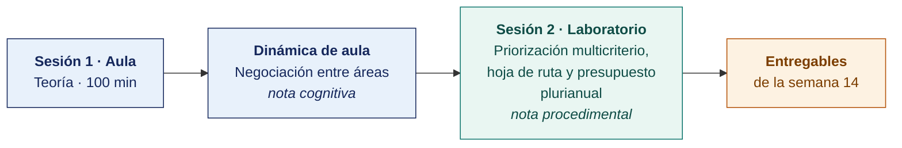

  
  &nbsp;&nbsp;&nbsp;&nbsp;&nbsp;&nbsp;
  

  <strong>Universidad Privada de Tacna</strong> 
  Facultad de Ingeniería · Escuela Profesional de Ingeniería de Sistemas

<h1 align="center">Semana 14</h1>
<h2 align="center">Priorización del Portafolio · Hoja de Ruta y Presupuesto</h2>

  <strong>SI-886 · Planeamiento Estratégico de TI</strong> 
  4 horas académicas de 50 min · 100 min de teoría con la dinámica incluida en aula · 100 min de taller en laboratorio

---

## Datos de la asignatura

| | |
|---|---|
| **Asignatura** | SI-886 · Planeamiento Estratégico de TI |
| **Escuela** | Escuela Profesional de Ingeniería de Sistemas |
| **Ciclo** | VIII · 04 horas semanales · 03 créditos · Obligatorio |
| **Unidad** | III — Plan Estratégico de TI |
| **Semana** | 14 de 17 |
| **Duración** | 4 horas académicas de 50 min · 100 min de teoría con la dinámica incluida en aula · 100 min de taller en laboratorio |
| **Resultados de aprendizaje** | **RA1** Aplica la guía metodológica para la elaboración de un Plan |

### Lo que indica el sílabo

**Contenido procedimental.** Priorizar y aprobar los proyectos de gobierno digital. Realizar el cronograma para un proyecto.

## Materiales de esta semana

| | Documento | Qué encontrarás | Dónde y cuánto dura |
|---|---|---|---|
| 1 | **[Teoría](1-TEORIA.md)** | Por qué priorizar es una decisión de gobierno · El método de priorización multicriterio · De la priorización a la hoja de ruta | Aula · 100 min |
| 2 | **[Dinámica de aula](2-DINAMICA.md)** | Negociación entre áreas, con su material, su ejemplo resuelto y su rúbrica | Aula · dentro de los 100 min de la sesión de teoría |
| 3 | **[Taller de laboratorio](3-TALLER.md)** | Priorización multicriterio, hoja de ruta y presupuesto plurianual | Laboratorio · 100 min |
| 4 | **[Recursos del taller](RECURSOS-TALLER/README.md)** | Los documentos del caso de cada organización y los programas que el taller usa, listos para copiar | Laboratorio · durante el taller |

## Ruta de la semana

## Entregables

| Entregable | Formato y nombre del archivo | Vence |
|---|---|---|
| **Dinámica de aula** · Negociación entre áreas | PDF desde la [plantilla de dinámica](../PLANTILLAS/SI886-PLANTILLA-DINAMICA.docx) · `SI886-S14-DINAMICA-Grupo<N>.pdf` | Según lo programado en el aula virtual |
| **Informe del taller de laboratorio N.º 14** | PDF en formato EPIS desde la [plantilla de taller](../PLANTILLAS/SI886-PLANTILLA-TALLER.docx) · `SI886-S14-TALLER-Grupo<N>.pdf` | Según lo programado en el aula virtual |
| Secciones Sección 7.2 a Sección 7.4 del PETI (Plan Estratégico de Tecnologías de Información) · etiqueta `v0.14` | Commit en Git | Según lo programado en el aula virtual |

> La dinámica y el informe del taller se entregan en **PDF**, con la carátula de la UPT y los códigos de todos los integrantes. Las plantillas obligatorias están en [`PLANTILLAS/`](../PLANTILLAS/).

## Cómo se evalúa

| Criterio | Instrumento | Peso |
|---|---|---|
| Cognitivo | Rúbrica de «Negociación entre áreas» + exposición de 10 min en la Semana 15 | 25 % |
| Procedimental | Lista de cotejo de los 13 resultados del laboratorio | 35 % |
| Actitudinal | Fijar los pesos **antes** de calcular y comunicar con honestidad lo que no se hará | 15 % |

## Preparación de la evidencia del Atributo del Graduado

> **Esta semana prepara la evidencia del atributo, y no se registra.** Las dos capturas que la Escuela fija son la de la **Semana 05** y la de la **Semana 16**. Lo que se produce aquí alimenta esas dos y **no modifica tu calificación** ni añade trabajo adicional.

| | |
|---|---|
| **Atributo** | **AG-I01 · El Profesional y el Mundo** |
| **Criterio medido** | **CD2** · Analiza y evalúa el impacto de las soluciones en el desarrollo sostenible |
| **Alineación con el sílabo** | **RA1** Aplica la guía metodológica para la elaboración de un Plan · Contenido procedimental del sílabo: «**Priorizar y aprobar** los proyectos de gobierno digital». El criterio de impacto es uno de los criterios con que se prioriza, no un añadido |
| **Evidencia que se lee** | `SI886-S14-TALLER-Grupo<N>.pdf` · matriz de priorización multicriterio |
| **Instrumento** | [Rúbrica AG-I01, escala 1–4](../ASSESSMENT/RUBRICAS-AG.md#ag-i01) |
| **Tipo de medición** | **Preparación de la evidencia** · no se registra |
| **Adónde va** | Alimenta la captura de la [Semana 16](../SEMANA-16/README.md) |

**Qué mira el evaluador.** Si el impacto social y ambiental pesa de verdad en la priorización —es decir, si **cambia el orden** de la cartera— o si es un párrafo decorativo junto a una decisión tomada solo por costo.

> **Ajuste de esta semana.** La matriz de priorización incluye el criterio **«Impacto social y ambiental»** con su peso, fijado **antes** de calcular, como el resto de criterios.

Mapa completo en [`ASSESSMENT/MAPA-AG.md`](../ASSESSMENT/MAPA-AG.md).

## Preparación para la Semana 15

- Leer. **ISO 31000:2018** — principios, marco y proceso de gestión del riesgo.
- Repasar la matriz de riesgo, sus escalas y el concepto de riesgo residual.
- Identificar, de forma preliminar, los tres riesgos que más probablemente impedirían ejecutar la hoja de ruta construida hoy.

---

**Docente** · Dr. Oscar Juan Jimenez Flores
[oscarjimenezflores@upt.pe](mailto:oscarjimenezflores@upt.pe) · [LinkedIn](https://www.linkedin.com/in/oscar-jimenez-flores/) · [CTI Vitae — CONCYTEC](https://ctivitae.concytec.gob.pe/appDirectorioCTI/VerDatosInvestigador.do?id_investigador=33398)

Escuela Profesional de Ingeniería de Sistemas · Universidad Privada de Tacna · Tacna, Perú
