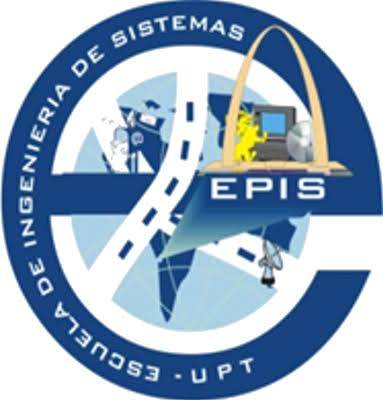

  
  &nbsp;&nbsp;&nbsp;&nbsp;&nbsp;&nbsp;
  

  <strong>Universidad Privada de Tacna</strong> 
  Facultad de Ingeniería · Escuela Profesional de Ingeniería de Sistemas

<h1 align="center">COOPAC FRONTERA SUR</h1>

  Banco de casos · <strong>Empresa 04</strong> · Cooperativa de ahorro y crédito 
  <em>Organización ficticia. Cualquier parecido con una empresa real es coincidencia.</em>

---

## A. Ficha de la organización

| Campo | Contenido |
|---|---|
| **Razón social** | COOPAC FRONTERA SUR |
| **Sector** | Cooperativa de ahorro y crédito |
| **Domicilio fiscal** | Tacna, con agencias en Tarata y Locumba |
| **RUC** | 20519XXXXX *(enmascarado; es una organización ficticia)* |
| **Años de operación** | 34 |
| **Personal en planilla** | 96 |
| **Personal adicional** | 12 promotores de campo |
| **Facturación / presupuesto anual** | S/ 189 millones en activos · 21 400 socios |
| **Mercado o población atendida** | Socios de Tacna y valles del interior |
| **Naturaleza** | Empresa privada. |
| **Entidades que la regulan o supervisan** | SBS (Resolución 504-2021 de gestión de seguridad de la información) · UIF-Perú · ANPD · SUNAT |

**Objetivo declarado para TI en el periodo.** Implementar de verdad el sistema de gestión de seguridad exigido por el regulador y hacerlo auditable.

## B. Estructura y gobierno

| | |
|---|---|
| **Personal de TI** | 5 personas |
| **Responsable de TI** | Jefe de TI, reporta a Gerencia General. Existe un Oficial de Seguridad de la Información con dedicación parcial |
| **Comité de TI o de gobierno digital** | Se reúne, pero no deja actas. |
| **Política de seguridad de la información** | No existe. |
| **Presupuesto de TI del periodo** | S/ 1 240 000 · 2.9 % de gastos operativos de la facturación |

> **Sin marco de gobierno digital obligatorio.** Al ser privada, las exigencias provienen de su regulador sectorial, de la Ley 29733 de protección de datos personales y de sus compromisos contractuales.

## C. Sistemas de información

| Sistema | Descripción | Dónde corre | Desde | ¿Tiene soporte vigente? |
|---|---|---|---|---|
| **Core financiero** | Producto especializado en cooperativas, licenciado | Servidor propio con réplica | 2017 | Sí, contrato con SLA |
| **Banca por internet para socios** | Módulo web del mismo proveedor | Nube del proveedor | 2021 | Sí |
| **Prevención de lavado de activos** | Sistema de alertas del proveedor | Servidor propio | 2019 | Sí |
| **Central de riesgos** | Consulta a bureau externo por servicio web | SaaS | 2018 | Sí |
| **Gestión documental de expedientes de crédito** | Carpetas compartidas en red | Servidor de archivos | 2015 | No |

**El problema que la organización reconoce.** La Resolución SBS 504-2021 exige un sistema de gestión de seguridad de la información con roles, riesgos y continuidad. Existe un documento redactado en 2022 que nunca se implementó ni se auditó.

## D. Procesos de negocio

| N.º | Proceso | ¿Qué sistema lo soporta? |
|---|---|---|
| 1 | Captación de ahorros | Core financiero |
| 2 | Evaluación y otorgamiento de créditos | Central de riesgos |
| 3 | Recuperaciones y cobranza | Core financiero |
| 4 | Prevención de lavado de activos | Prevención de lavado de activos |
| 5 | Atención al socio en agencias | Banca por internet para socios |
| 6 | Cierre contable y reportes a la SBS | Core financiero |

## E. Instrumentos de planeamiento existentes

| Instrumento | ¿Existe? | Vigencia | Estado real |
|---|---|---|---|
| Plan estratégico o plan de negocio | Sí | 2023–2027 | Aprobado, pero no se ha revisado desde su aprobación. |
| Plan operativo anual | Sí | 2025 | Se formula cada año para efectos presupuestales. |
| Plan Estratégico de Tecnologías de la Información (PETI) | **No** | — | **Nunca se ha formulado.** |
| Plan de transformación digital | No | — | No se ha formulado. |
| Política de seguridad de la información | No | — | No existe. |
| Plan de continuidad del negocio | No | — | No existe. El BIA de `datos/bia.csv` es un borrador incompleto elaborado por un practicante. |
| Catálogo de servicios de TI | No | — | Sin responsable asignado. |

## F. Situación de TI — hechos verificables para el diagnóstico

Son los hechos que la organización admite y que pueden darse por ciertos. Todo lo demás se pregunta en la entrevista.

| Aspecto | Situación verificada |
|---|---|
| **Gestión de cambios** | Hay un formato de cambio que se llena después de aplicar el cambio. |
| **Inventario de activos de TI** | No existe. |
| **Contraseñas** | No hay política escrita. La longitud mínima del sistema principal es de seis caracteres. |
| **Registro de incidentes** | No se registra. Se resuelve y se olvida. |
| **Segundo factor de autenticación** | Está disponible en el sistema principal pero no se activó para evitar resistencia de los usuarios. |
| **Contratos con proveedores de TI** | No hay control de vencimientos; se detectan cuando el proveedor deja de responder. |
| **Capacitación en seguridad** | Se hizo una charla de una hora en la inducción, hace tres años. |
| **Respaldos** | Se ejecutan a un disco externo que permanece conectado al mismo servidor. |

## G. El incidente del periodo

**Acceso indebido a expedientes de crédito**

Un analista consultó y descargó 1 900 expedientes de crédito de socios que no le correspondían durante cuatro meses. Se detectó por denuncia interna, no por control. El servidor de archivos no registraba accesos de lectura.

## H. Riesgos que la organización ya conoce y no ha tratado

| N.º | Riesgo conocido | ¿Tratado? |
|---|---|---|
| 1 | Incumplimiento verificable de la Resolución SBS 504-2021 | No |
| 2 | Sin registro de accesos de lectura a información de socios | No |
| 3 | Plan de continuidad sin pruebas documentadas | No |

## I. Datos entregados

Los siete archivos de `datos/` corresponden al periodo del 1 de enero al 31 de diciembre de 2025. Fueron generados con la semilla de esta empresa. **No coinciden con los de ningún otro equipo**.

| Archivo | Qué contiene | Registros |
|---|---|---|
| `pagos.csv` | Población de pagos del periodo — comprobante, fecha, proveedor, concepto, monto, quién registró y quién aprobó | 28 016 |
| `proveedores.csv` | Maestro de proveedores con su contacto y documento de identidad | 60 |
| `empleados.csv` | Planilla del periodo, con fechas de ingreso y cese | 96 |
| `usuarios_erp.csv` | Usuarios del ERP con su perfil, último acceso y estado | 75 |
| `bia.csv` | Análisis de impacto al negocio por proceso, con RTO, RPO y fecha de la última prueba | 6 |
| [`presupuesto_ti.csv`](presupuesto_ti.csv) | Presupuesto de TI del periodo por partida, planificado contra ejecutado | 7 |
| [`inversiones_cerradas.csv`](inversiones_cerradas.csv) | Tres inversiones cerradas con su beneficio declarado y si se midió | 3 |

---

**Docente** · Dr. Oscar Juan Jimenez Flores
[oscarjimenezflores@upt.pe](mailto:oscarjimenezflores@upt.pe) · [LinkedIn](https://www.linkedin.com/in/oscar-jimenez-flores/) · [CTI Vitae — CONCYTEC](https://ctivitae.concytec.gob.pe/appDirectorioCTI/VerDatosInvestigador.do?id_investigador=33398)

Escuela Profesional de Ingeniería de Sistemas · Universidad Privada de Tacna · Tacna, Perú
