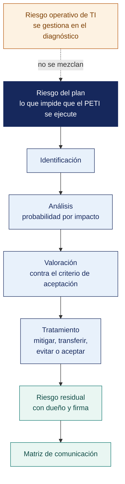

[Semana 15](README.md) · **Teoría** · [Dinámica de aula](2-DINAMICA.md) · [Taller de laboratorio](3-TALLER.md)

# Semana 15

## Gestión de Riesgos del Plan

**SI-886 · Planeamiento Estratégico de TI** · Sesión 1 en aula · 2 horas académicas, 100 min, con la dinámica incluida

> ¿Un término no le resulta claro? Está definido en el [glosario técnico del curso](../GLOSARIO.md).

---

## Supuesto y pregunta

Un plan aprobado incluye un registro de riesgos de sesenta y dos entradas, entre ellas la caída del centro de datos, el ataque de ransomware, la rotura de un enlace y la falla del aire acondicionado.

Pero el plan no se ejecuta — la jefatura de TI cambia de titular a los cuatro meses, el nuevo titular no conoce el plan y nadie lo reclama—, y ese riesgo no estaba en las sesenta y dos entradas.

> **¿Qué riesgos pertenecen al plan y cuáles pertenecen a la operación?**

## Mapa de la sesión



---

## 1. Qué riesgo gestiona la sección 8 del PETI

> **¿Qué podría impedir que este plan se ejecute como está escrito?**

**La distinción que hay que fijar de entrada.** El PETI trata **tres clases de riesgo distintas**, y confundirlas produce un registro inútil:

| Clase | Qué amenaza | Dónde vive en el plan | Ejemplo |
|---|---|---|---|
| **Riesgo del plan** | La **ejecución del propio PETI** | **Sección 8 — esta semana** | «El presupuesto se recorta a la mitad en el año 2» |
| **Riesgo de TI de la organización** | La operación tecnológica cotidiana | Diagnóstico Sección 4.3 (APO12) y proyectos derivados | «Falla el servidor único del ERP» |
| **Riesgo del negocio** | Los objetivos de la organización | Fuera del alcance del PETI; se recoge del PEI (Plan Estratégico Institucional) | «Caída de la demanda del sector» |

> **La sección 8 gestiona el primero.** Un registro que mezcla las tres clases produce un documento de 80 riesgos que nadie usa. **El riesgo del plan responde a una sola pregunta. ¿Qué podría impedir que este plan se ejecute como está escrito?**

> **El error frecuente del bloque.** Copiar el registro de riesgos operativos de TI en la sección de riesgos del plan. Produce un documento de ochenta entradas que nadie usa y que **no contiene el riesgo de que el plan no se ejecute**, que es el único que esta sección existe para gestionar.

## 2. El proceso de gestión del riesgo — ISO 31000:2018

> **¿Cómo se enuncia un riesgo para que se pueda tratar?**

```
   ┌──────────── ALCANCE, CONTEXTO Y CRITERIOS ────────────┐
   │                                                       │
   │   APRECIACIÓN DEL RIESGO                              │
   │     ├─ Identificación                                 │   Comunicación
   │     ├─ Análisis      (probabilidad × impacto)         │   y consulta
   │     └─ Valoración    (comparar con el criterio)       │        ↕
   │                       │                               │   Seguimiento
   │   TRATAMIENTO DEL RIESGO                              │   y revisión
   │     Evitar · Mitigar · Transferir · Aceptar · Asumir  │
   │                       │                               │
   │   RIESGO RESIDUAL → ACEPTACIÓN FORMAL                 │
   └───────────────────────────────────────────────────────┘
```

**Los ocho principios de la ISO 31000:2018.** La gestión del riesgo debe ser — **integrada**, **estructurada y exhaustiva**, **adaptada** al contexto, **inclusiva**, **dinámica**, basada en la **mejor información disponible**, considerar **factores humanos y culturales**, y estar en **mejora continua**.

**Las escalas — se fijan antes de evaluar.**

| Probabilidad | Definición operativa para un plan a 3 años |
|---|---|
| 1 Muy baja | Requeriría una circunstancia excepcional; sin antecedentes |
| 2 Baja | Ha ocurrido alguna vez en organizaciones comparables |
| 3 Media | Ocurre en aproximadamente la mitad de los planes similares |
| 4 Alta | Ocurre habitualmente; hay antecedentes en esta organización |
| 5 Muy alta | Es prácticamente seguro que ocurra en el horizonte del plan |

| Impacto | Efecto sobre el plan |
|---|---|
| 1 Insignificante | Retraso menor a un mes en un proyecto |
| 2 Menor | Retraso de un trimestre en un proyecto |
| 3 Moderado | Un proyecto se posterga un año o se reduce su alcance |
| 4 Mayor | Un objetivo del plan no se alcanza; una ola completa se retrasa |
| 5 Catastrófico | El plan se abandona, o se incurre en incumplimiento normativo sancionable |

**Criterio de aceptación** (se acuerda con la gerencia). Riesgos con valor **≤ 6** pueden aceptarse documentadamente; **> 6** exigen plan de tratamiento con responsable y plazo; **≥ 15** exigen decisión de la gerencia general antes de aprobar el plan.

> **El error frecuente del bloque.** Enunciar el riesgo como un sustantivo. «Rotación de personal» no se puede tratar porque no dice qué pasa ni a qué afecta. **Un riesgo se enuncia como un suceso con su causa y su efecto** —«el especialista renuncia y el proyecto queda sin quien lo continúe»—, y solo entonces el tratamiento es evidente.

## 3. Los riesgos característicos de un PETI

> **¿Cuáles se repiten en casi todos los planes y por qué?**

Nueve categorías. **Cada plan debe evaluar las nueve**, aunque descarte algunas con justificación:

| # | Categoría | Riesgo típico | Señal temprana | Tratamiento habitual |
|---|---|---|---|---|
| **1** | **Presupuestal** | El presupuesto se recorta o se reasigna a otra prioridad | El presupuesto de TI no se aprueba en la fecha habitual | Aprobación plurianual formal; hitos de decisión por ola |
| **2** | **Patrocinio** | El patrocinador del plan deja el cargo o pierde interés | Ausencia del patrocinador en dos comités consecutivos | Patrocinio en un comité, no en una persona; acta de aprobación |
| **3** | **Capacidad de ejecución** | El área de TI no puede sostener los proyectos simultáneos | Los proyectos avanzan pero ninguno cierra | Reducir simultaneidad; tercerizar lo no diferenciador |
| **4** | **Dependencia de personal clave** | Renuncia quien concentra el conocimiento crítico | Un solo nombre aparece en todos los proyectos | Proyecto de gestión del conocimiento **en la ola 1** |
| **5** | **Resistencia al cambio** | Los usuarios no adoptan lo entregado | Baja participación en pilotos; uso paralelo del proceso anterior | Gestión del cambio dimensionada según sección 2.4; pilotos con usuarios líderes |
| **6** | **Proveedor** | El proveedor incumple, quiebra o eleva el precio | Retrasos reiterados; rotación del equipo del proveedor | Cláusulas de nivel de servicio y penalidad; plan de salida documentado |
| **7** | **Técnico** | La solución no funciona como se esperaba o no integra | Prueba de concepto pospuesta repetidamente | Prueba de concepto **antes** de comprometer el presupuesto |
| **8** | **Normativo** | Cambia la norma durante la ejecución del plan | Prepublicación de un proyecto normativo | Vigilancia normativa; diseño con margen de adaptación |
| **9** | **De alcance** | El plan crece sin control con pedidos no previstos | Proyectos que aparecen sin caso de negocio | Regla de admisión de sección 7.1; control de cambios del plan |

**El riesgo que casi ningún plan registra.** *«El plan se aprueba y nadie lo ejecuta porque no se asignó responsable ni se estableció seguimiento»*. Su tratamiento es la sección 10 del propio plan.

## 4. Tratamiento, riesgo residual y comunicación

> **¿Qué se hace con el riesgo que queda después del tratamiento?**

**Las cinco decisiones de tratamiento.**

| Decisión | Cuándo | Ejemplo en un PETI |
|---|---|---|
| **Evitar** | El riesgo es inaceptable y la actividad prescindible | Retirar del plan un proyecto cuya tecnología no está madura |
| **Mitigar** | Se puede reducir probabilidad o impacto a costo razonable | Prueba de concepto antes de la compra; formación de un segundo responsable |
| **Transferir** | Un tercero puede asumir mejor la consecuencia | Cláusula de penalidad con el proveedor; garantía contractual |
| **Aceptar** | El riesgo está bajo el criterio y el costo de tratarlo supera el beneficio | Riesgo de valor 4, documentado y firmado |
| **Asumir con contingencia** | No se puede evitar ni transferir, pero se prepara la respuesta | Plan alternativo si el presupuesto se recorta |

> **Regla no negociable.** Un riesgo aceptado **sin firma del dueño del riesgo** no está aceptado. Está ignorado, y así debe reportarse.

**La comunicación del riesgo.** El sílabo lo pide explícitamente. Un tratamiento que nadie conoce no opera. La matriz de comunicación del riesgo define, para cada riesgo de valor > 6. **Qué se comunica, a quién, con qué frecuencia, por qué canal y quién lo comunica**.

**Ejemplo trabajado — el registro de riesgos del plan de la distribuidora, de la valoración al residual.** Criterio acordado con la gerencia. Valor ≤ 6 aceptable con firma; > 6 exige tratamiento; ≥ 15 exige decisión de la gerencia general **antes** de aprobar el plan.

| # | Riesgo del plan | P | I | **Valor** | Decisión | Tratamiento concreto | P′ | I′ | **Residual** |
|---|---|---|---|---|---|---|---|---|---|
| R-01 | El jefe de sistemas —único que conoce el portal y el ERP— renuncia durante la ola 1 | 4 | 5 | **20** | **Mitigar** | Documentación de la arquitectura y formación de un segundo responsable, dentro de PR-03, ola 1 | 4 | 3 | **12** |
| R-02 | El proveedor único del ERP, la app de ventas y la facturación eleva el precio o incumple | 3 | 5 | **15** | **Transferir** | Renegociación con niveles de servicio, penalidad y plan de salida documentado antes de ampliar el alcance | 2 | 4 | **8** |
| R-03 | El presupuesto de TI se recorta en el año 2 | 3 | 4 | **12** | **Asumir con contingencia** | Hito de decisión al cierre de cada ola; PR-02 etapificado para poder detenerse tras la etapa 1 | 3 | 2 | **6** |
| R-04 | El personal de almacén vuelve a las hojas de cálculo tras la reactivación del módulo | **5** | 4 | **20** | **Mitigar** | Gestión del cambio con 12 % del presupuesto de PR-01, piloto con el almacén de Ilo y cierre técnico de la hoja paralela | 3 | 4 | **12** |
| R-05 | La ANPD fiscaliza antes de que PR-05 concluya | 2 | 4 | **8** | **Mitigar** | PR-05 en el primer semestre; registro de tratamiento como primer entregable | 1 | 4 | **4** |
| R-06 | Se aprueba el plan y nadie lo ejecuta. Sin responsable ni seguimiento | 4 | 5 | **20** | **Evitar** | El comité de TI sesiona trimestralmente por acta; dueño designado por objetivo; sección 10 del plan | 2 | 5 | **10** |

> **Los tres riesgos de valor 20 no son técnicos. Son de personas y de gobierno.** R-01 y R-04 nacen del mismo diagnóstico —una sola persona que sabe, y un sistema que ya se abandonó una vez—, y R-06 es el que ningún equipo registra porque incomoda. **El plan que se aprueba y se archiva**. Ninguno de los tres baja del umbral 6 después del tratamiento, y esa es la información honesta que la gerencia necesita antes de firmar. **El residual se reporta como queda, no como conviene que se vea**.

> **Microaplicación (6 min). Los tres riesgos que sí amenazan su plan.** Cada pareja escribe **tres riesgos de su propio plan**, con causa y efecto, y comprueba que ninguno sea un riesgo operativo de TI. El que sobreviva a esa comprobación entra en la sección 8.

| Caso | Qué debe contener una buena respuesta |
|---|---|
| ¿Por qué R-01 mantiene probabilidad 4 después del tratamiento? | Porque documentar y formar a un segundo responsable no reduce la probabilidad de que alguien renuncie. Reduce el impacto. Bajar la probabilidad ahí sería maquillar el registro |
| ¿Puede aceptarse un residual de 12? | Solo con decisión y firma del dueño del riesgo, y con seguimiento declarado. **Aceptar no es ignorar.** Es asumir por escrito, con nombre |
| ¿Qué distingue a R-04 de un riesgo de TI de la organización? | Que amenaza la **ejecución del plan**, no la operación. El riesgo operativo del almacén ya está en el diagnóstico; aquí lo que se gestiona es que el proyecto fracase en la adopción |

## Cierre

**La respuesta a la pregunta con la que abrimos.** Al plan pertenece lo que amenaza **su ejecución**; a la operación, lo que amenaza el servicio. La caída del centro de datos es un riesgo operativo y ya está en el diagnóstico. El cambio de titular sin transferencia del plan es un riesgo del plan, es el más frecuente de todos y es el que faltaba en las sesenta y dos entradas.

**Las tres ideas que deben quedar.**

| Idea | Por qué importa en el ejercicio profesional |
|---|---|
| El riesgo del plan responde a una sola pregunta | Qué podría impedir que este plan se ejecute como está escrito |
| Un riesgo se enuncia como suceso con causa y efecto, nunca como sustantivo | «Rotación de personal» no se puede tratar; «el especialista renuncia y el proyecto se detiene» sí |
| El riesgo residual se acepta con nombre y firma del dueño del riesgo | Aceptar no es ignorar, es asumir por escrito y con seguimiento declarado |

**Lo que suele fallar frente a este caso.** La tercera pregunta —de quién es el riesgo de que el plan no se ejecute— casi siempre se responde señalando a la gerencia. Es del plan, y su tratamiento se escribe en la sección de implantación del propio documento.

**Lo que sigue.** La [dinámica de esta sesión](2-DINAMICA.md) construye el registro de riesgos del plan propio con la prueba de causa y efecto. El taller lo completa con la valoración, el tratamiento y el residual aceptado.

---

---

[Semana 15](README.md) · **Teoría** · [Dinámica de aula](2-DINAMICA.md) · [Taller de laboratorio](3-TALLER.md)

---

**Docente** · Dr. Oscar Juan Jimenez Flores
[oscarjimenezflores@upt.pe](mailto:oscarjimenezflores@upt.pe) · [LinkedIn](https://www.linkedin.com/in/oscar-jimenez-flores/) · [CTI Vitae — CONCYTEC](https://ctivitae.concytec.gob.pe/appDirectorioCTI/VerDatosInvestigador.do?id_investigador=33398)

Escuela Profesional de Ingeniería de Sistemas · Universidad Privada de Tacna · Tacna, Perú
