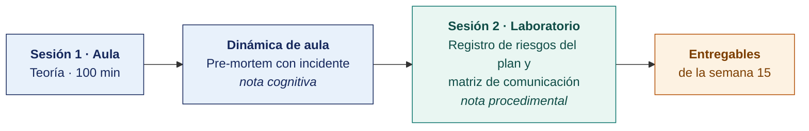

  
  &nbsp;&nbsp;&nbsp;&nbsp;&nbsp;&nbsp;
  

  <strong>Universidad Privada de Tacna</strong> 
  Facultad de Ingeniería · Escuela Profesional de Ingeniería de Sistemas

<h1 align="center">Semana 15</h1>
<h2 align="center">Gestión de Riesgos del Plan</h2>

  <strong>SI-886 · Planeamiento Estratégico de TI</strong> 
  4 horas académicas de 50 min · 100 min de teoría con la dinámica incluida en aula · 100 min de taller en laboratorio

---

## Datos de la asignatura

| | |
|---|---|
| **Asignatura** | SI-886 · Planeamiento Estratégico de TI |
| **Escuela** | Escuela Profesional de Ingeniería de Sistemas |
| **Ciclo** | VIII · 04 horas semanales · 03 créditos · Obligatorio |
| **Unidad** | III — Plan Estratégico de TI |
| **Semana** | 15 de 17 |
| **Duración** | 4 horas académicas de 50 min · 100 min de teoría con la dinámica incluida en aula · 100 min de taller en laboratorio |
| **Resultados de aprendizaje** | **RA1** Aplica la guía metodológica para la elaboración de un Plan |

### Lo que indica el sílabo

**Contenido conceptual.** Gestionar riesgos.

**Contenido procedimental.** Identifica los riesgos y definir la acción para su tratamiento. Comunicar las acciones para tratar el riesgo.

## Materiales de esta semana

| | Documento | Qué encontrarás | Dónde y cuánto dura |
|---|---|---|---|
| 1 | **[Teoría](1-TEORIA.md)** | Qué riesgo gestiona la sección 8 del PETI · El proceso de gestión del riesgo — ISO 31000:2018 · Los riesgos característicos de un PETI | Aula · 100 min |
| 2 | **[Dinámica de aula](2-DINAMICA.md)** | Pre-mortem con incidente, con su material, su ejemplo resuelto y su rúbrica | Aula · dentro de los 100 min de la sesión de teoría |
| 3 | **[Taller de laboratorio](3-TALLER.md)** | Registro de riesgos del plan y matriz de comunicación | Laboratorio · 100 min |
| 4 | **[Recursos del taller](RECURSOS-TALLER/README.md)** | Los documentos del caso de cada organización y los programas que el taller usa, listos para copiar | Laboratorio · durante el taller |

## Ruta de la semana

## Entregables

| Entregable | Formato y nombre del archivo | Vence |
|---|---|---|
| **Dinámica de aula** · Pre-mortem con incidente | PDF desde la [plantilla de dinámica](../PLANTILLAS/SI886-PLANTILLA-DINAMICA.docx) · `SI886-S15-DINAMICA-Grupo<N>.pdf` | Según lo programado en el aula virtual |
| **Informe del taller de laboratorio N.º 15** | PDF en formato EPIS desde la [plantilla de taller](../PLANTILLAS/SI886-PLANTILLA-TALLER.docx) · `SI886-S15-TALLER-Grupo<N>.pdf` | Según lo programado en el aula virtual |
| Sección 8 del PETI · etiqueta `v0.15` | Commit en Git | Según lo programado en el aula virtual |

> La dinámica y el informe del taller se entregan en **PDF**, con la carátula de la UPT y los códigos de todos los integrantes. Las plantillas obligatorias están en [`PLANTILLAS/`](../PLANTILLAS/).

## Cómo se evalúa

| Criterio | Instrumento | Peso |
|---|---|---|
| Cognitivo | Rúbrica del pre-mortem + exposición de 10 min en la Semana 16 | 25 % |
| Procedimental | Lista de cotejo de los 14 resultados del laboratorio | 35 % |
| Actitudinal | Redacción de los riesgos de personas por cargo, sin juicios individuales | 15 % |

## Preparación para la Semana 16

- **Consolidar todas las secciones Sección 0 a Sección 8** del PETI (Plan Estratégico de Tecnologías de Información). La Semana 16 las integra en un documento único.
- **Leer.** RSGD 005-2018-PCM/SEGDI, Anexo I — estructura completa y proceso de aprobación del Plan de Gobierno Digital.
- Coordinar con la organización una **sesión de revisión del documento** antes de su aprobación formal.
- Cada equipo revisará su propio PETI contra la lista de coherencia en el laboratorio de la Semana 16.

---

**Docente** · Dr. Oscar Juan Jimenez Flores
[oscarjimenezflores@upt.pe](mailto:oscarjimenezflores@upt.pe) · [LinkedIn](https://www.linkedin.com/in/oscar-jimenez-flores/) · [CTI Vitae — CONCYTEC](https://ctivitae.concytec.gob.pe/appDirectorioCTI/VerDatosInvestigador.do?id_investigador=33398)

Escuela Profesional de Ingeniería de Sistemas · Universidad Privada de Tacna · Tacna, Perú
