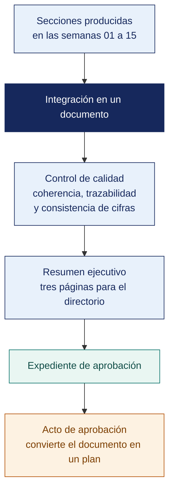

[Semana 16](README.md) · **Teoría** · [Dinámica de aula](2-DINAMICA.md) · [Taller de laboratorio](3-TALLER.md)

# Semana 16

## El Plan de Gobierno Digital · Integración, Revisión y Aprobación

**SI-886 · Planeamiento Estratégico de TI** · Sesión 1 en aula · 2 horas académicas, 100 min, con la dinámica incluida

> ¿Un término no le resulta claro? Está definido en el [glosario técnico del curso](../GLOSARIO.md).

---

## Supuesto y pregunta

Un plan de ciento veinte páginas llega al comité con las once secciones completas, cada una revisada por su responsable, y ninguna tiene errores.

Pero el objetivo 3 no tiene ningún proyecto que lo mueva, y el proyecto PR-07, que se lleva el 22 % del presupuesto, no se articula a ningún objetivo. Las dos cosas son visibles en treinta segundos si se leen las dos secciones a la vez, y nadie las leyó a la vez.

> **¿Qué le puede faltar a un plan con todas sus secciones correctas para que el directorio lo apruebe?**

## Mapa de la sesión

---

## 1. Del conjunto de secciones al documento

> **¿Dónde viven los defectos que ninguna revisión por secciones encuentra?**

**El error de la integración tardía.** Un PETI (Plan Estratégico de Tecnologías de Información) construido semana a semana tiene un riesgo característico. **Las secciones son correctas por separado y contradictorias entre sí**. La integración no es concatenar archivos; es verificar la coherencia de la cadena completa.

**Los siete puntos de coherencia que deben verificarse.**

| # | Punto de coherencia | Inconsistencia típica |
|---|---|---|
| 1 | **Visión → objetivos** | La visión promete 60 % de canal digital y ningún objetivo lo mide |
| 2 | **Diagnóstico → estrategias** | Estrategias que responden a factores que el diagnóstico no identificó |
| 3 | **Estrategias → objetivos** | Estrategias sin objetivo, u objetivos sin estrategia de origen |
| 4 | **Objetivos → proyectos** | Objetivos sin ningún proyecto que los alcance |
| 5 | **Proyectos → presupuesto** | Proyectos en la hoja de ruta que no figuran en el presupuesto |
| 6 | **Arquitectura → proyectos** | Brechas de arquitectura sin paquete de trabajo asociado |
| 7 | **Riesgos → tratamiento → plan** | Tratamientos que exigen recursos no presupuestados |

> **La verificación de coherencia es un control de calidad automatizable.** Los identificadores usados de forma consistente durante todo el semestre —OD-xx, E-xx, PR-xx, R-xx, PT-xx— permiten comprobarla con un script en lugar de con una lectura completa.

**Ejemplo trabajado — la verificación de coherencia sobre un plan terminado.** Se ejecuta contra los identificadores del propio documento, no leyéndolo de corrido. Resultado de la primera pasada sobre el PETI de la distribuidora:

| # | Comprobación | Resultado | Hallazgo concreto | Qué se corrige |
|---|---|---|---|---|
| 1 | Toda meta de la visión tiene objetivo que la mide | **Falla** | La visión promete «inventario confiable» y ningún OD mide la diferencia contable-físico | Se agrega **OD-05** con línea base 4.7 % |
| 2 | Toda estrategia cita factores existentes en sección 3.4 | **Falla** | **E-07** cita el factor **O5**, que no existe. Quedó fuera al depurar el PESTEL | Se elimina E-07 o se reincorpora O5 con su evidencia |
| 3 | Todo objetivo procede de al menos una estrategia | OK | — | — |
| 4 | Todo objetivo tiene al menos un proyecto | **Falla** | **OD-04** (capacidad del personal) no tiene proyecto. Se supuso cubierto por PR-06 | Se declara el alcance en PR-06 o se crea PR-08 |
| 5 | Todo proyecto de la hoja de ruta está en el presupuesto | **Falla** | **PR-05** figura en la ola 1 con S/ 0: se presupuestó como «horas internas» sin valorizar | Se valoriza en S/ 34 000 y se ajusta el total del año 1 |
| 6 | Toda brecha de arquitectura tiene paquete de trabajo | OK | — | — |
| 7 | Todo tratamiento de riesgo tiene recurso presupuestado | **Falla** | El tratamiento de **R-04** exige 12 % de gestión del cambio, no incluido en el costo de PR-01 | Se incrementa PR-01 en S/ 21 000 |

> **Cinco inconsistencias en un plan cuyas nueve secciones eran correctas por separado.** Cuatro de las cinco cambian el presupuesto o el portafolio, y ninguna se habría detectado leyendo el documento de corrido — **se detectan cruzando identificadores**. Ese es el argumento para usar códigos —OD-xx, E-xx, PR-xx, R-xx, PT-xx— desde la primera semana y no al final.

> **Microaplicación (6 min). Las dos comprobaciones cruzadas.** Cada equipo abre sus dos secciones —objetivos y cartera— y responde por escrito **cuántos objetivos no tienen proyecto y cuántos proyectos no tienen objetivo**. El número casi nunca es cero la primera vez.

| Caso | Qué debe contener una buena respuesta |
|---|---|
| ¿Por qué se verifica la coherencia y no basta con revisar cada sección? | Porque las inconsistencias viven **entre** secciones, no dentro de ellas. Cada sección puede ser impecable y el conjunto contradecirse |
| Un objetivo sin proyecto, ¿es error del objetivo o del portafolio? | De cualquiera de los dos, y hay que decidirlo. O el objetivo no era alcanzable con los recursos del plan y se retira, o falta un proyecto y se agrega con su presupuesto |
| ¿Qué se hace con la observación de un gerente que el equipo considera equivocada? | Se registra, se rechaza con justificación técnica y se deja constancia en el acta de revisión. Aceptarla en silencio traslada al equipo la responsabilidad de un plan que sabe defectuoso |

> **El error frecuente del bloque.** Revisar el plan sección por sección y darlo por verificado. Las inconsistencias viven **entre** secciones, no dentro de ellas, y por eso un documento en el que cada capítulo es impecable puede contradecirse en el conjunto.

## 2. La estructura del documento final

> **¿Para quién se escribe cada parte del documento?**

**Contraste con la estructura exigida por los Lineamientos del PGD.**

| Componente exigido por los Lineamientos (RSGD 005-2018-PCM/SEGDI) | Sección del PETI de este curso |
|---|---|
| 1. Introducción y marco normativo | Sección 0 Presentación · Sección 1.2.5 · Sección 4.1 |
| 2. Situación actual: análisis interno y externo | Sección 3 completo · Sección 5.2 · Sección 6.1 |
| 3. Alineamiento estratégico | Sección 1.2 · Sección 2 · Sección 6.2 (articulación) |
| 4. Objetivos de gobierno digital | Sección 6.2 |
| 5. Portafolio de proyectos | Sección 7.1 y Sección 7.2 |
| 6. Gestión de riesgos | Sección 8 |
| 7. Cronograma e implementación | Sección 7.3 · Sección 7.4 · Sección 10 |
| 8. Supervisión y evaluación | Sección 10 |
| 9. Anexos | Anexos |
| **Adicionales de este curso** | Sección 4.2–4.3 marcos y madurez · Sección 5 arquitectura empresarial |

> **Conclusión.** El PETI construido en el curso **cubre íntegramente el PGD** y añade dos capas —marcos de gestión con evaluación de madurez, y arquitectura empresarial— que refuerzan la calidad del diagnóstico y la justificación del portafolio.

**La jerarquía de lectura.** El documento tiene tres audiencias con tiempos distintos:

| Audiencia | Qué lee | Extensión |
|---|---|---|
| **Directorio o titular de la entidad** | Resumen ejecutivo y Sección 9 (aprobación) | 3 páginas |
| **Gerencias de área** | Resumen, Sección 6.2 objetivos, Sección 7 portafolio, Sección 10 implementación | 20 páginas |
| **Jefatura de TI y equipo** | Documento completo con anexos | Todo |

**El resumen ejecutivo del PETI** —tres páginas, la sección más difícil de escribir:

| Bloque | Contenido | Extensión |
|---|---|---|
| 1. Dónde estamos | Nivel de madurez, tres brechas críticas, exposición normativa | ½ página |
| 2. Hacia dónde vamos | Visión de TI y los N objetivos con su meta | ½ página |
| 3. Cómo llegamos | Las tres olas y sus proyectos principales | ½ página |
| 4. Cuánto cuesta | CAPEX, OPEX y la curva de gasto operativo | ½ página |
| 5. **Qué NO haremos** | Proyectos descartados y el riesgo asumido | ¼ página |
| 6. **Qué riesgos asume la organización** | Riesgos residuales ≥ criterio que requieren firma | ¼ página |
| 7. **Qué decisión se solicita** | Lo que el órgano de gobierno debe aprobar hoy | ½ página |

> **El error frecuente del bloque.** Escribir el resumen ejecutivo como una introducción. La gerencia lee esas dos páginas y a menudo ninguna más. **El resumen ejecutivo dice qué se propone, cuánto cuesta y qué se obtiene**, y si empieza describiendo la metodología ya perdió a su único lector.

## 3. La aprobación formal del plan

> **¿Qué convierte un documento técnico en un plan vigente?**

**Por qué la aprobación es una sección del plan y no un trámite.** Un plan sin acto formal de aprobación no obliga a nadie. En el sector público la aprobación es un requisito normativo; en el privado es lo que permite exigir su ejecución.

**Requisitos del acto de aprobación.**

| Elemento | Sector público | Sector privado |
|---|---|---|
| **Quién aprueba** | El **titular de la entidad**, con opinión previa del Comité de Gobierno Digital | Directorio o gerencia general |
| **Instrumento** | Resolución del titular | Acta de directorio o de comité |
| **Vigencia** | **Mínimo 3 años**, con actualización y evaluación anual | 3 a 5 años, revisión anual |
| **Publicación** | Portal institucional de transparencia | Difusión interna |
| **Responsable de la ejecución** | **Líder de Gobierno Digital** | Responsable designado del plan |
| **Anexo obligatorio** | Aceptación firmada de los riesgos residuales | Ídem |

**El expediente de aprobación** que el equipo prepara:

1. **Documento del PETI** completo, en versión final.
2. **Resumen ejecutivo** de 3 páginas.
3. **Presentación de aprobación** de 12 diapositivas, para una sesión de 20 minutos.
4. **Proyecto de acta o resolución** de aprobación, redactado.
5. **Anexo de aceptación de riesgos residuales**, con los espacios de firma.
6. **Acta de la revisión** realizada con la organización, con las observaciones y su tratamiento.

**La revisión previa con la organización.** Antes de la aprobación se realiza una sesión de revisión en la que la organización observa el documento. Cada observación se registra con quién la formuló (por cargo), qué sección afecta, si se acepta o se rechaza, la justificación del rechazo si corresponde, y el cambio realizado. **Un equipo que acepta todas las observaciones sin discutir ninguna no revisó. Cedió.**

## Cierre

**La respuesta a la pregunta con la que abrimos.** Porque los defectos de un plan viven **entre** las secciones. Un objetivo sin proyecto y un proyecto sin objetivo son cada uno correctos dentro de su capítulo, y juntos significan que el plan promete algo que no financia y financia algo que no prometió. Se detectan con dos comprobaciones cruzadas que caben en media hora.

**Las tres ideas que deben quedar.**

| Idea | Por qué importa en el ejercicio profesional |
|---|---|
| La verificación de coherencia es cruzada, no por secciones | Objetivos contra cartera, cartera contra presupuesto, riesgos contra hoja de ruta |
| Un objetivo sin proyecto obliga a decidir, no a explicar | O el objetivo se retira porque no era alcanzable, o falta un proyecto y se agrega con su presupuesto |
| La observación que se rechaza también se registra | Aceptar en silencio una observación equivocada deja al equipo con un plan que sabe defectuoso |

**Lo que suele fallar frente a este caso.** La respuesta más frecuente a la primera pregunta es revisar mejor cada sección, y revisarlas mejor por separado no habría encontrado nada. Lo que falta es **leer dos secciones a la vez**.

**Lo que sigue.** La [dinámica de esta sesión](2-DINAMICA.md) somete el plan propio a las comprobaciones cruzadas y produce la lista de inconsistencias con su decisión. El taller integra después el documento final y lo lleva al acta de aprobación.

**Pregunta de cierre.** *si el titular firma hoy, ¿quién ejecuta mañana y con qué autoridad?* Si el plan no nombra un responsable con autoridad y un órgano de seguimiento, la firma solo cambia el estado del archivo.
---

---

[Semana 16](README.md) · **Teoría** · [Dinámica de aula](2-DINAMICA.md) · [Taller de laboratorio](3-TALLER.md)

---

**Docente** · Dr. Oscar Juan Jimenez Flores
[oscarjimenezflores@upt.pe](mailto:oscarjimenezflores@upt.pe) · [LinkedIn](https://www.linkedin.com/in/oscar-jimenez-flores/) · [CTI Vitae — CONCYTEC](https://ctivitae.concytec.gob.pe/appDirectorioCTI/VerDatosInvestigador.do?id_investigador=33398)

Escuela Profesional de Ingeniería de Sistemas · Universidad Privada de Tacna · Tacna, Perú
