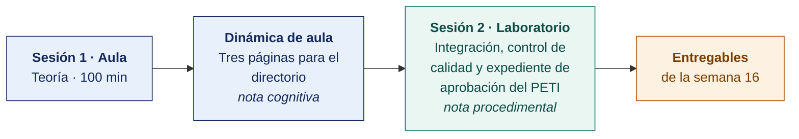

  
  &nbsp;&nbsp;&nbsp;&nbsp;&nbsp;&nbsp;
  

  <strong>Universidad Privada de Tacna</strong> 
  Facultad de Ingeniería · Escuela Profesional de Ingeniería de Sistemas

<h1 align="center">Semana 16</h1>
<h2 align="center">El Plan de Gobierno Digital · Integración, Revisión y Aprobación</h2>

  <strong>SI-886 · Planeamiento Estratégico de TI</strong> 
  4 horas académicas de 50 min · 100 min de teoría con la dinámica incluida en aula · 100 min de taller en laboratorio

---

## Datos de la asignatura

| | |
|---|---|
| **Asignatura** | SI-886 · Planeamiento Estratégico de TI |
| **Escuela** | Escuela Profesional de Ingeniería de Sistemas |
| **Ciclo** | VIII · 04 horas semanales · 03 créditos · Obligatorio |
| **Unidad** | III — Plan Estratégico de TI |
| **Semana** | 16 de 17 |
| **Duración** | 4 horas académicas de 50 min · 100 min de teoría con la dinámica incluida en aula · 100 min de taller en laboratorio |
| **Resultados de aprendizaje** | **RA1** Aplica la guía metodológica para la elaboración de un Plan |

### Lo que indica el sílabo

**Contenido conceptual.** Plan de gobierno digital.

**Contenido procedimental.** Elabora y aprueba el cronograma de actividades. Elabora el plan de gobierno digital. Revisar y aprobar el plan de gobierno digital.

## Materiales de esta semana

| | Documento | Qué encontrarás | Dónde y cuánto dura |
|---|---|---|---|
| 1 | **[Teoría](1-TEORIA.md)** | Del conjunto de secciones al documento · La estructura del documento final · La aprobación formal del plan | Aula · 100 min |
| 2 | **[Dinámica de aula](2-DINAMICA.md)** | Sesión de directorio, con su material, su ejemplo resuelto y su rúbrica | Aula · dentro de los 100 min de la sesión de teoría |
| 3 | **[Taller de laboratorio](3-TALLER.md)** | Integración, control de calidad y expediente de aprobación del PETI | Laboratorio · 100 min |
| 4 | **[Recursos del taller](RECURSOS-TALLER/README.md)** | Los documentos del caso de cada organización y los programas que el taller usa, listos para copiar | Laboratorio · durante el taller |

## Ruta de la semana

## Entregables

| Entregable | Formato y nombre del archivo | Vence |
|---|---|---|
| **Dinámica de aula** · Sesión de directorio | PDF desde la [plantilla de dinámica](../PLANTILLAS/SI886-PLANTILLA-DINAMICA.docx) · `SI886-S16-DINAMICA-Grupo<N>.pdf` | Según lo programado en el aula virtual |
| **Informe del taller de laboratorio N.º 16** | PDF en formato EPIS desde la [plantilla de taller](../PLANTILLAS/SI886-PLANTILLA-TALLER.docx) · `SI886-S16-TALLER-Grupo<N>.pdf` | Según lo programado en el aula virtual |
| **PETI v1.0 integrado y expediente de aprobación** | Repositorio Git con la etiqueta `v1.0` | 72 h después del laboratorio |

> La dinámica y el informe del taller se entregan en **PDF**, con la carátula de la UPT y los códigos de todos los integrantes. Las plantillas obligatorias están en [`PLANTILLAS/`](../PLANTILLAS/).

## Cómo se evalúa

| Criterio | Instrumento | Peso |
|---|---|---|
| Cognitivo | Rúbrica del resumen ejecutivo + exposición de 10 min en la Semana 17 | 25 % |
| Procedimental | Lista de cotejo de los 14 resultados del laboratorio | 35 % |
| Actitudinal | Rigor en la verificación de coherencia del propio plan y trato profesional en la mesa de aprobación | 15 % |

## Medición del Atributo del Graduado

> Esta semana la Escuela recoge evidencia para el **Plan de Assessment**. La rúbrica del atributo se aplica sobre el mismo entregable que ya produces. **No modifica tu calificación** ni añade trabajo adicional.

| | |
|---|---|
| **Atributo** | **AG-I01 · El Profesional y el Mundo** |
| **Criterio medido** | **CD1 + CD2** · Los dos criterios del atributo |
| **Alineación con el sílabo** | **RA1** Aplica la guía metodológica para la elaboración de un Plan · Contenido procedimental del sílabo: «Elabora el plan de gobierno digital. **Revisar y aprobar** el plan de gobierno digital» · Evidencia de la competencia de la asignatura: **Plan de Tecnologías de Información y cartera de proyectos** |
| **Evidencia que se lee** | PETI v1.0 · sección **«Impacto de la cartera en el desarrollo sostenible»** y sección de contexto |
| **Instrumento** | [Rúbrica AG-I01, escala 1–4](../ASSESSMENT/RUBRICAS-AG.md#ag-i01) |
| **Tipo de medición** | **Captura 2 · sumativa** · grupal |
| **Se registra en** | [`ASSESSMENT/REGISTRO-AG-SI886.csv`](../ASSESSMENT/REGISTRO-AG-SI886.csv) |

**Qué mira el evaluador.** El documento integrado, leído como lo leería el directorio de la organización. Si el plan sostiene qué cambia para las personas, con qué costo y bajo qué marco legal.

> **Ajuste de esta semana.** El PETI v1.0 incorpora la sección **«Impacto de la cartera en el desarrollo sostenible»**, de dos a tres páginas, que consolida las columnas de impacto de las Semanas 13 y 14. Es la evidencia sumativa del atributo.

Mapa completo en [`ASSESSMENT/MAPA-AG.md`](../ASSESSMENT/MAPA-AG.md).

## Preparación para la Semana 17

- Preparar la **sustentación de 6 minutos** ante panel — 2 de presentación, 2 de demostración y 2 de preguntas, una por integrante.
- Ensayar el resumen ejecutivo **sin diapositivas**. Quien no puede explicar su plan en tres minutos hablando no lo domina.
- Imprimir y anillar el **expediente completo** del PETI (Plan Estratégico de Tecnologías de Información).
- Preparar el **examen de Unidad III**. Semanas 13 a 17.
- Invitar, si es posible, a un representante de la organización a la sustentación.

---

**Docente** · Dr. Oscar Juan Jimenez Flores
[oscarjimenezflores@upt.pe](mailto:oscarjimenezflores@upt.pe) · [LinkedIn](https://www.linkedin.com/in/oscar-jimenez-flores/) · [CTI Vitae — CONCYTEC](https://ctivitae.concytec.gob.pe/appDirectorioCTI/VerDatosInvestigador.do?id_investigador=33398)

Escuela Profesional de Ingeniería de Sistemas · Universidad Privada de Tacna · Tacna, Perú
