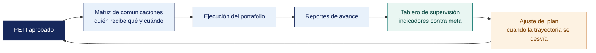

[Semana 17](README.md) · **Teoría** · [Dinámica de aula](2-DINAMICA.md) · [Taller de laboratorio](3-TALLER.md)

# Semana 17

## Implementación y Supervisión del Plan · Sustentación · Examen de Unidad III

**SI-886 · Planeamiento Estratégico de TI** · Sesión 1 en aula · 2 horas académicas, 100 min, con la dinámica incluida

> ¿Un término no le resulta claro? Está definido en el [glosario técnico del curso](../GLOSARIO.md).

---

## Supuesto y pregunta

Un equipo sustenta su plan ante el panel —describe la metodología, enumera las once secciones, explica cómo levantó el diagnóstico— y se le acaban los seis minutos antes de decir qué propone hacer con el dinero de la organización.

Otro equipo abre diciendo que **propone invertir S/ 480 000 en tres años para reducir de doce a cuatro días el tiempo de atención de un expediente**, muestra la hoja de ruta que lo sostiene y le sobra un minuto.

> **Después de diecisiete semanas de trabajo, ¿qué es lo primero que hay que decirle al panel?**

## Mapa de la sesión

---

## Sustentación final ante panel

Cada equipo sustenta **el PETI completo y su cartera de proyectos** ante el panel. **6 minutos por equipo**, 10 equipos. Es la evidencia de la competencia de la asignatura y el momento en que se califica a cada integrante por separado.

| Momento | Duración | Qué se evalúa |
|---|---|---|
| Presentación del producto terminado | 2 min | Qué resuelve y para quién |
| **Demostración sobre el producto real** | 2 min | Funcionando. No diapositivas de lo que hace |
| Pregunta individual del panel | 2 min | **Una por integrante.** Se registra el nivel alcanzado en el acta |

> **La pregunta individual es obligatoria y se registra.** Es la única evidencia individual del curso. Sin ella, el dato del Atributo del Graduado sería grupal y no reportable por estudiante.

## Examen de Unidad III

El Examen de Unidad se rinde en dos partes, y juntas valen el 25 % de la nota de la unidad.

| Parte | Dónde y cuándo | Duración | Qué evalúa | Materiales |
|---|---|---|---|---|
| **Teórico** | Aula, al cierre de esta sesión | 40 min | Preguntas de alternativas sobre las Semanas 13 a 16 | Apuntes propios. **Sin** internet ni asistentes de inteligencia artificial |
| **Práctico** | Laboratorio | 100 min | Cruzar identificadores entre secciones y detectar lo que no cuadra, que es exactamente el trabajo de la Semana 16 | Laboratorio de cómputo, **con inteligencia artificial permitida** y declarada |

## Cierre

**La respuesta a la pregunta con la que abrimos.** Lo primero es **qué se propone y cuánto cuesta**. El método sostiene la propuesta, no la sustituye, y un panel que no sabe qué se propone no puede evaluar cómo se llegó. Es la misma regla del resumen ejecutivo de la Semana 16, aplicada a la voz.

**Lo que el curso deja.** Un plan completo, del diagnóstico a la hoja de ruta, sobre una organización real. Lo que se lleva no son las matrices, que se olvidan, sino el hábito de no proponer nada que no pueda articularse a un objetivo y sostenerse con una cifra.

**La pregunta individual del panel.** Es la única evidencia individual del curso y se registra en el acta. Cada integrante responde sobre una parte del trabajo que hizo. Responder «eso lo hizo mi compañero» es la única respuesta que no admite recuperación.

---

---

[Semana 17](README.md) · **Teoría** · [Dinámica de aula](2-DINAMICA.md) · [Taller de laboratorio](3-TALLER.md)

---

**Docente** · Dr. Oscar Juan Jimenez Flores
[oscarjimenezflores@upt.pe](mailto:oscarjimenezflores@upt.pe) · [LinkedIn](https://www.linkedin.com/in/oscar-jimenez-flores/) · [CTI Vitae — CONCYTEC](https://ctivitae.concytec.gob.pe/appDirectorioCTI/VerDatosInvestigador.do?id_investigador=33398)

Escuela Profesional de Ingeniería de Sistemas · Universidad Privada de Tacna · Tacna, Perú
