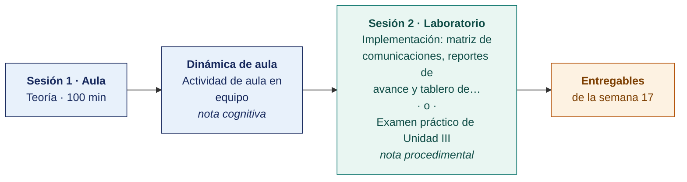

  
  &nbsp;&nbsp;&nbsp;&nbsp;&nbsp;&nbsp;
  

  <strong>Universidad Privada de Tacna</strong> 
  Facultad de Ingeniería · Escuela Profesional de Ingeniería de Sistemas

<h1 align="center">Semana 17</h1>
<h2 align="center">Implementación y Supervisión del Plan · Sustentación · Examen de Unidad III</h2>

  <strong>SI-886 · Planeamiento Estratégico de TI</strong> 
  4 horas académicas de 50 min · 100 min de sustentación ante panel y examen de unidad en aula · 100 min de taller en laboratorio

---

## Datos de la asignatura

| | |
|---|---|
| **Asignatura** | SI-886 · Planeamiento Estratégico de TI |
| **Escuela** | Escuela Profesional de Ingeniería de Sistemas |
| **Ciclo** | VIII · 04 horas semanales · 03 créditos · Obligatorio |
| **Unidad** | III — Plan Estratégico de TI (cierre) |
| **Semana** | 17 de 17 |
| **Duración** | 4 horas académicas de 50 min · 100 min de sustentación ante panel y examen de unidad en aula · 100 min en laboratorio, compartidos entre el taller y el examen práctico |
| **Resultados de aprendizaje** | **RA1** Aplica la guía metodológica para la elaboración de un Plan |

### Lo que indica el sílabo

**Contenido conceptual.** Implementación del Plan.

**Contenido procedimental.** Elabora una matriz de comunicaciones. Solicitar los reportes de avance. Elabora el reporte de supervisión del Plan de gobierno digital.

## Materiales de esta semana

| | Documento | Qué encontrarás | Dónde y cuánto dura |
|---|---|---|---|
| 1 | **[Teoría](1-TEORIA.md)** | Sustentación del PETI ante panel · Examen de Unidad III | Aula · 100 min |
| 2 | **[Dinámica de aula](2-DINAMICA.md)** | Actividad en equipo, con su material, su ejemplo resuelto y su rúbrica | **Trabajo previo**, se entrega antes de la sesión |
| 3 | **[Taller de laboratorio](3-TALLER.md)** | Matriz de comunicaciones, reportes de avance y tablero de supervisión | Laboratorio · 100 min · **comparte sesión con el examen práctico** |
| 4 | **[Recursos del taller](RECURSOS-TALLER/README.md)** | Los documentos del caso de cada organización y los programas que el taller usa, listos para copiar | Laboratorio · durante el taller |

> **El laboratorio de esta semana lo reclaman dos documentos y solo caben los 100 minutos de una sesión.** El **examen práctico** y el **[taller](3-TALLER.md)** están escritos completos y son independientes entre sí. El docente publica en el aula virtual el que ocupará la sesión y deja el otro como trabajo fuera de ella, y lo comunica al inicio de la semana. **El plazo no cambia con esa decisión** — ambos vencen contando desde la sesión de laboratorio, que se dicta igual en cualquiera de los dos casos.

## Ruta de la semana

## Entregables

| Entregable | Formato y nombre del archivo | Vence |
|---|---|---|
| **Sustentación ante panel** | PDF de las diapositivas · `SI886-S17-SUSTENTACION-Grupo<N>.pdf` | Según lo programado en el aula virtual |
| **Informe del taller de laboratorio N.º 17** | PDF en formato EPIS desde la [plantilla de taller](../PLANTILLAS/SI886-PLANTILLA-TALLER.docx) · `SI886-S17-TALLER-Grupo<N>.pdf` | Según lo programado en el aula virtual |
| Sustentación ante panel | 6 min por equipo · 10 equipos en 60 min | Sesión de teoría |
| **Examen teórico de Unidad III** | Presencial, 40 min, Preguntas de alternativas | Sesión de aula |
| **Examen práctico de Unidad III** | 100 min, individual, con inteligencia artificial permitida y declarada | Sesión de laboratorio, si el docente le asigna la sesión |
| **PETI FINAL completo** | Repositorio Git con las etiquetas `v1.1` y `entrega-final`, más el PDF y su hash | 72 h después de la sesión de laboratorio |
| **Entrega del PETI a la organización** | PDF + presentación + expediente de aprobación, con acta de entrega | Antes del cierre del semestre |

> La dinámica y el informe del taller se entregan en **PDF**, con la carátula de la UPT y los códigos de todos los integrantes. Las plantillas obligatorias están en [`PLANTILLAS/`](../PLANTILLAS/).

## Cómo se evalúa

| Criterio | Instrumento | Peso en la unidad |
|---|---|---|
| Actitudinal | Participación, puntualidad, profesionalismo con la organización y cumplimiento del acuerdo de confidencialidad en las semanas 13–17 | 15 % |
| Cognitivo | Rúbricas de las dinámicas S13–S16 + **sustentación ante panel** | 25 % |
| Procedimental | Listas de cotejo de los laboratorios 13–17 + **calidad del PETI FINAL** | 35 % |
| Examen de Unidad | **Teórico** en aula, 40 min, banco de alternativas · **Práctico** en laboratorio, 100 min, sobre los productos de los talleres, con IA permitida | 25 % |
| | **La Unidad III aporta el 40 % de la nota final del curso** | |

## Preparación de la evidencia del Atributo del Graduado

> **Esta semana prepara la evidencia del atributo, y no se registra.** Las dos capturas que la Escuela fija son la de la **Semana 05** y la de la **Semana 16**. Lo que se produce aquí alimenta esas dos y **no modifica tu calificación** ni añade trabajo adicional.

| | |
|---|---|
| **Atributo** | **AG-I01 · El Profesional y el Mundo** |
| **Criterio medido** | **CD2** · Analiza y evalúa el impacto de las soluciones en el desarrollo sostenible |
| **Alineación con el sílabo** | Evidencia de la competencia de la asignatura: **Plan de Tecnologías de Información y cartera de proyectos** · Plan de evaluación del sílabo, criterio cognitivo: «rúbricas de las dinámicas S13–S16 + **sustentación ante panel**» |
| **Evidencia que se lee** | `SI886-S17-SUSTENTACION-Grupo<N>.pdf` y la **respuesta individual** de cada integrante ante el panel |
| **Instrumento** | [Rúbrica AG-I01, escala 1–4](../ASSESSMENT/RUBRICAS-AG.md#ag-i01) |
| **Tipo de medición** | **Preparación de la evidencia** · no se registra |
| **Adónde va** | Alimenta la captura de la [Semana 16](../SEMANA-16/README.md) |

**Qué mira el evaluador.** La respuesta de cada integrante, por separado, a una pregunta sobre el impacto de un proyecto de la cartera. Refuerza el criterio CD2 sobre el trabajo que ya se evaluó en la captura de la Semana 16.

> **Ajuste de esta semana.** El panel formula a **cada integrante** una pregunta sobre el impacto de un proyecto de la cartera, y registra el nivel alcanzado en el acta. Los 8 minutos de preguntas ya previstos bastan para ello.

Mapa completo en [`ASSESSMENT/MAPA-AG.md`](../ASSESSMENT/MAPA-AG.md).

## Cierre del curso — la evidencia de la competencia

> **Competencia de la asignatura.** *Diagnostica y elabora el plan de TI de la organización con la cartera de proyectos.*
> **Evidencias.** Plan de Tecnologías de Información · Cartera de proyectos.

**Trazabilidad de la competencia.**

| Unidad | Producto acumulado | Contribución a la evidencia |
|---|---|---|
| I (S01–S06) | Sección 0 a Sección 3.2. Identidad estratégica y diagnóstico base | Aporta el **«diagnostica»** de la competencia |
| II (S07–S12) | Sección 3.3 a Sección 6.2 — diagnóstico estratégico, normativa, marcos, arquitectura y objetivos | Aporta la **evidencia y el criterio** que sostienen el plan |
| III (S13–S17) | Sección 7 a Sección 10 — portafolio, riesgos, aprobación e implementación | **Es el «elabora el plan» y la «cartera de proyectos»** |

**Nota final del curso.** Unidad I × 25 % + Unidad II × 35 % + Unidad III × 40 %.

**Lo que el estudiante se lleva.** Un Plan Estratégico de Tecnologías de Información completo, construido sobre evidencia, entregado a una organización real y sustentado ante un panel. Cada línea del portafolio es rastreable hasta un hecho del diagnóstico. Ese documento es material de portafolio profesional y la base directa para ejercer como analista o consultor de planeamiento de TI.

---

**Docente** · Dr. Oscar Juan Jimenez Flores
[oscarjimenezflores@upt.pe](mailto:oscarjimenezflores@upt.pe) · [LinkedIn](https://www.linkedin.com/in/oscar-jimenez-flores/) · [CTI Vitae — CONCYTEC](https://ctivitae.concytec.gob.pe/appDirectorioCTI/VerDatosInvestigador.do?id_investigador=33398)

Escuela Profesional de Ingeniería de Sistemas · Universidad Privada de Tacna · Tacna, Perú
